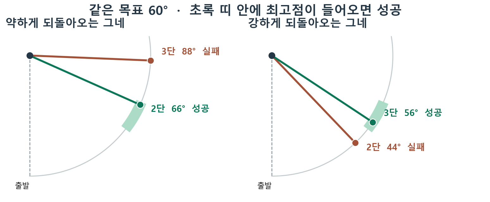

# #38 중력 실험 · 그네를 얼마나 세게 밀어야 할까

후속 작업에서 탐색 전후의 사진으로 복원 계수를 구하고 이를 행동 조건부 예측기에 직접 연결했다. [구현 위치와 새 행동 비교](probe_integration/README.md)

경첩에 점성 감쇠를 추가한 후속 관문에서 공개 Flow 잔차, 감쇠 계수, 각도 회귀, 작은 각도 Flow의 실제 힘 선택을 검증했다. [감쇠 관문 결과](damping_gate/README.md)

**같은 그네도 되돌리는 중력이 강해지면 한 단계 더 세게 밀어야 목표에 닿는 경우가 있었다. 약하게 한 번 밀어 본 사진에는 그 차이를 판단할 단서가 담겼다.**

## 이미 있던 실험과 이번 실험

이전 밀기에서는 같은 힘으로 밀어도 바닥에 따라 목표 앞에서 멈추거나 목표를 지나쳤다. 버튼에서는 아무것도 시도하지 않는 모델이 실패를 피해서 더 높은 점수를 받기도 했다. [이전 물리 결과](../fm38_materials_20261123/README.md#행동-자체의-순위) · [이전 모델 점수](../fm38_materials_20261123/README.md#모델이-실제로-선택한-행동의-가치)

이번에는 판에 진자를 매달았다. 판을 눕히거나 세우면 지구 중력은 그대로지만 진자를 출발점으로 되돌리는 힘이 달라진다. 카메라는 판을 정면으로 보므로 가만히 있는 진자의 사진은 양쪽에서 같다. 네 가지 세기 중 하나를 반드시 골라야 하고, 첫 최고점이 목표각의 ±7.5도 안에 들면 1회 성공이다.



목표가 59.9도였던 485번 장면에서 2단 밀기의 최고점은 65.9도 → 43.6도, 3단은 87.6도 → 56.4도였다. 먼저 약하게 밀고 0.55초 뒤에 본 각도만으로도 38.4도 → 16.8도 차이가 났다. 이 그림은 실제 궤적의 최고점을 각도로 다시 그렸다.

## 관찰과 정답

| 역할 | 무엇을 하나 | 비유 |
|---|---|---|
| 본 행동 | 같은 시작점에서 네 세기로 각각 밀어 모든 선택의 결과를 확인한다. | 같은 문제에서 네 답을 다 시험해 얻은 채점표 |
| 연습 밀기 | 일정하게 약한 세기로 한 번 밀고 0.55초 뒤의 사진을 하나 받는다. 원위치로 되돌린 뒤 본 행동을 고른다. | 처음 보는 자전거에서 브레이크를 한번 가볍게 잡아 보는 것 |
| 세 모델 | 공개 Flow-JEPA, 네 갈래 미래를 예측하는 혼합 모델, 비슷한 시범 32개를 찾는 검색 모델이 같은 사진과 목표를 본다. | 미래를 상상하거나 예전 사례를 찾아 밀기 세기를 고른다. |
| 물리식 대조군 | 막대 길이·추의 크기·밀기 세기·경과 시간·운동 방정식을 알고, 사진에서 추의 중심을 읽어 중력을 역산한다. 사진만 주면 훈련 때의 평균 중력을 쓴다. | 어떤 단서가 화면에 들어 있는지 확인하는 이론 기준 |

원래 판 기울기는 25~45도, 시험의 더 가파른 범위는 65~85도다. 각 범위에 9개 기울기를 썼다. 각각 진자를 되돌리는 중력 성분이 4.15~6.94, 8.89~9.77 m/s²이다. 출발각과 목표를 고정해 서로 짝지은 미사용 시험 512개에서 각 세기를 실행했다. 두 행동의 성공과 실패가 서로 맞바뀐 장면은 **267/512개, 52.1%**였다. 포기와 시도 중 선택했던 앞 실험과 이번 성공률은 척도가 다르다. [사전 비교 기준](protocol.md) · [엔진 코드](swing.py)

## 모델과 검증 방법

원 물성에서 무작위로 수집한 궤적 2,048개를 학습하고 별도 192개 시작점으로 모델을 선택했다. 각 학습형 모델은 같은 훈련 시범을 같은 순서로 사용했고 학습 초기값 세 개를 돌렸다. 연습 사진이 있는 경우와 없는 경우를 같은 미니배치에 넣어 두 관찰 조건이 같은 가중치를 쓰게 했다. 시험 시에는 시드·난수를 조건 간에 맞췄다. 검색은 결정적이다.

Flow-JEPA는 저자가 공개한 **Reacher 가중치**에서 시작해 시각 인코더와 projector를 고정하고 동역학·행동 인코더를 원 물성 데이터로 미세조정했다. 운영체제에 설치된 Transformers판의 ViT 층 이름을 일대일 대응시키고 가중치·키·크기를 검사했다. 나머지 두 모델도 동일한 고정 이미지 표현을 썼다. 모델은 현재 및 연습 사진으로 미래 다섯 장면의 표현을 생성하거나 검색한다. 모든 모델은 같은 원 물성 자료에서 학습한 각도 판독기와 행동당 32개 궤적을 사용한다. 공개 모델은 Euler 적분 8회다. 원 데이터셋의 보상이나 제어기를 사용한 벤치마크와 구분한다. [모델 코드](models.py) · [원저자 코드](https://github.com/HuoYanchen/Flow-JEPA/tree/6b6a88b45a93ba1bcb2ce65af6c2003e771fe376) · [저자 가중치](https://huggingface.co/HuoYanchen/Flow-JEPA/tree/f26a1a5f3d1e0aeeb68377a7e7463088f244c79c/flow-jepa-reacher)

실제 정답은 MuJoCo가 0.002초 간격으로 측정한 첫 최고점이다. 각도 판독기를 실제 미래 다섯 장면에 적용했을 때 읽은 최고점과 엔진의 최고점 차이는 평균 0.82도(원 물성), 1.12도(새 물성)였다. 시험에 쓰인 모든 행동에서 에너지 보존식으로 따로 구한 각도와 엔진 최고점의 차이가 0.01도 미만임을 확인했다. 3개 시작점 × 네 행동 × 두 물성의 궤적과 연습 밀기를 다시 실행했을 때 저장본과 정확히 일치했다. [판독과 학습 기록](run.json)

## 연습으로 한 번 밀어 본 뒤 성공률이 얼마나 바뀌었나

| 방법 | 익숙한 기울기에서 정지 사진 → 연습 사진 추가 | 처음 보는 가파른 기울기에서 정지 사진 → 연습 사진 추가 |
|---|---:|---:|
| 공개 Flow-JEPA 미세조정 | 24.3% → 24.0% | 14.3% → 14.6% |
| 혼합 예측기 | 59.4% → 67.6% | 17.7% → 19.7% |
| 시범 검색 | 65.6% → 77.0% | 14.5% → 21.5% |
| 물리식을 알고 사진에서 중력을 추정하는 대조군 | 66.8% → 83.8% | 13.1% → **74.8%** |
| 네 세기 중 무작위 선택의 기대 성공률 | 21.0% | 22.2% |
| 원 물성 검증에서 고른 상수 세기의 성공률 | 22.7% | 10.2% |
| 네 행동 중 성공하는 것이 하나라도 있는 비율 | 84.0% | **75.0%** |

학습 시드를 시작점 안에서 평균하고 같은 512개 시작점을 64,000번 다시 뽑았다. 사전에 정한 12개 차이 전체에 95% 동시 구간을 적용했다. 가파른 판에서 연습 사진 덕분에 성공률이 올라간 정도는 검색 **+7.0%p [3.7, 10.7]**, 혼합 +2.0%p [−0.8, 4.7], Flow +0.3%p [−1.3, 1.9]였다. 익숙한 판에서는 검색 +11.3%p [6.4, 16.2], 혼합 +8.2%p [4.2, 12.1]였고 Flow는 −0.3%p [−2.5, 2.0]였다. 연습 사진을 썼을 때 두 물성 사이에서 세 모델 중 두 방법의 우열이 뒤집혔다고 판정된 쌍은 없었다. 새 기울기에서 검색은 자기 자신의 사진 한 장 조건을 이겼지만 평균 성공률은 여전히 무작위 선택에 가까웠다.

실제 역전 267개 장면에는 양쪽에서 모두 성공하는 고정 행동이 하나도 없었다. 시범 검색이 연습 사진으로 **같은 장면의 두 기울기 모두 알맞게 골랐던 비율**은 13.9%, 혼합은 9.5%, Flow는 2.2%였다. 이 267개에서는 정지 화면만 주면 세 방법 모두 양쪽을 한꺼번에 맞힐 수 없다. [모든 시드의 결과](results.json)

## 물리식으로는 왜 풀렸나

같은 힘으로 밀고 같은 시간을 기다렸는데 한쪽 진자가 이미 더 빨리 내려왔다면, 그 궤적을 만든 중력 범위를 좁힐 수 있다. 대조군은 카메라 픽셀로 추의 위치를 읽고 예상되는 연습 위치와 비교한다. 이렇게 추정한 중력 성분의 평균 절대 오차는 원 범위 0.067, 새 범위 0.097 m/s²였다. 다음으로 운동에너지가 최고점에서 위치에너지로 바뀐다는 식으로 네 세기의 최고점을 계산했다. 가파른 판에서 **383/512회 성공**했고, 네 세기로 성공 가능한 장면은 **384/512개**였다. 이 대조군은 장치의 구조·운동 법칙을 미리 알고 있다. 학습 모델의 데이터만으로 이 식을 발견했다는 증거는 없다.

## 한계와 추천

고정 카메라, 정확한 세기의 밀기, 마찰 없는 경첩, 길이가 일정한 단진자를 사용한 시뮬레이션이다. 연습 동작에는 0.55초와 원상 복귀가 필요하다. 시각부를 공유하고 후보·표본 수를 맞췄지만 계산 시간과 사전학습량을 맞추지는 않았다. 세 시드는 같은 학습 시범을 보므로 구간은 새로운 데이터 수집에 따른 불확실성을 포함하지 않는다.

다음 연구 질문으로는 연습 사진에서 되돌리는 힘을 작은 모델로 직접 추정하고, 그 값으로 네 세기의 최고점을 계산하게 했을 때 중력을 보지 못한 새 장면에서 얼마나 맞히는지가 적합하다. 이번 실험은 카메라에 필요한 정보가 있는지와 기존 방법이 그 정보를 꺼내 쓰는지를 구분할 수 있는 기준을 제공한다.

## 재현

기본 자료 경로는 E:/0.Project/fm38_visual/swing이다. 환경 변수 FM38_DATA로 상위 저장 경로를 바꿀 수 있다. 먼저 MuJoCo 4.0.1 환경에서 궤적을 만들고, CUDA PyTorch 2.11.0·Transformers 5.5.4 환경에서 세 모델을 학습한다. 공개 Reacher 체크포인트는 필요하면 models.py가 내려받는다. 배포본 가중치 SHA-256은 `83395e2883fb301fdfa91d5794691b6720054aa3e06dec3fafa5d4cba3ebb3c9`이다. FLOW_JEPA_SOURCE가 없으면 작업공간의 research-sources/Flow-JEPA를 사용한다.

```powershell
python swing.py
python models.py
python evaluate.py
python figure.py
```

저장된 선택 점수와 정답에서 통계만 다시 계산할 때는 `python evaluate.py --from-archive`를 실행한다. [선택 점수](forecasts.npz) · [물리 정답과 대조군 선택](outcomes.npz) · [분석 코드](evaluate.py) · [전체 결과](results.json)
