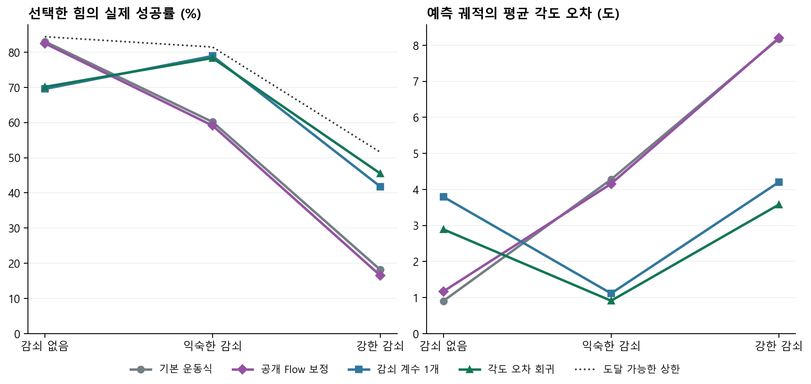

# #38 감쇠 관문 · 그네가 힘을 잃을 때 Flow가 밀기 세기를 더 잘 고르는가

**기존 공개 Flow-JEPA의 영상 잔차 보정은 관문을 통과하지 못했다.** 강한 감쇠에서 기본 운동식의 성공률 18.2%가 보정 후 16.5%가 됐다. 같은 관측으로 각도 오차를 직접 회귀하면 45.5%였다. 별도 새 시험에서 각도 오차를 직접 생성하는 작은 Flow도 기본 운동식보다 성공률을 높였으나, 더 단순한 회귀를 이기지는 못했다.

## 이미 있던 것과 새로 만든 것

기존 #38 예측기는 약한 연습 밀기 전후의 RGB에서 그네의 복원 계수를 추정하고, 네 밀기 세기의 기본 궤적을 만든다. 공개 Reacher Flow-JEPA가 생성하는 영상 표현의 잔차를 여기에 더해 각도를 보정한다. [기존 구현](../../../../research-sources/le-wam/src/probe_planner.py) · [이전 무감쇠 시험](../probe_integration/README.md)

이번에는 실제 경첩에서 에너지가 계속 빠져나가게 만들었다. 그네 기울기는 세 시험 모두 25~45도라는 같은 범위를 썼다. 각 출발각·기울기·목표·본 행동을 짝지어 감쇠만 바꿨다. 힘이 빠지지 않는 대조, 익숙한 감쇠, 처음 보는 강한 감쇠에서 각각 같은 512개 출발점에 네 행동을 모두 실행했다. [사전 기준](protocol.md) · [물리 환경](world.py) · [새 학습 코드](run.py) · [보정기](controls.py)

| 역할 | 무엇을 하나 | 비유 |
|---|---|---|
| 기본 운동식 | 되돌아오는 힘 하나를 연습 사진으로 추정한다. 마찰 없는 진자로 미래를 전개한다. | 축에서 에너지가 빠져나가는 현상을 생략한 계산 |
| 공개 Flow 보정 | 공개 Reacher 가중치에서 시각부를 고정하고, 기본 궤적과 실제 미래 영상 표현의 차이를 원 감쇠 시범으로 학습한다. | 기본 예측 영상에서 잘못 그린 부분을 수정 |
| 감쇠 계수 1개 | 훈련 시범에서 속도에 비례하는 저항 계수 하나를 적합한다. 그 값을 고정한 채 연습 사진마다 복원 계수를 다시 추정한다. | 축이 얼마나 뻑뻑한지 평균값 하나 추가 |
| 각도 오차 회귀 | 시작·연습 각도, 추정 복원 계수, 밀기 세기, 기본 궤적으로 다섯 시점의 각도 오차를 직접 예측한다. 제곱·교차항을 쓴 ridge 회귀다. | 몇 도 빗나가는지를 직접 고치는 표 |

참값은 MuJoCo의 첫 오른쪽 최고점이다. 허용 오차는 목표의 ±7.5도이고 포기는 없다. 감쇠를 c라 할 때 엔진 운동은 q″=−k sin(q)−c q′이다. 경첩에 설정한 점성 계수는 관성모멘트 × c다. 학습 c는 0.6~1.4 s⁻¹, 강감쇠는 2.0~2.8 s⁻¹다. c와 경사를 모델 입력으로 주지 않았다. 단순 물리 보정기의 c는 훈련 영상만으로 1.1 s⁻¹가 선택됐다. 알려진 k,c를 대입한 별도 적분기의 위치는 모든 시험 궤적에서 MuJoCo와 0.000002도 이내로 일치했다. 무작위 표본이 아닌 사전 고정한 세 출발점에서 36개 행동 궤적과 연습 밀기를 다시 실행해 저장된 값과 같은지 확인했다. [MuJoCo 경첩 감쇠 설명](https://mujoco.readthedocs.io/en/stable/XMLreference.html#body-joint-damping)

## 주 시험

각 모델은 2,048개 원 범위 시범에서 학습했다. 원 범위 검증 출발점 192개로 보정 세기를 정하고, 시험 512개는 남겨 두었다. 각도 오차는 네 행동의 다섯 미래 시점에서 예측 평균과 실제 각도의 절대 차이를 잰 값이다. 행동 선택 시에는 각 경로의 최고점으로 성공 확률을 계산했다. 하나라도 성공하는 행동이 있는 비율이 해당 환경의 성능 상한이다.

| 방법 | 익숙한 감쇠 성공률 → 강한 감쇠 성공률 | 익숙한 감쇠 궤적 오차 → 강한 감쇠 궤적 오차 |
|---|---:|---:|
| 기본 운동식 | 60.2% → 18.2% | 4.28° → 8.18° |
| 공개 Flow 보정, 검증에서 고른 세기 | 59.1% → 16.5% | 4.16° → 8.20° |
| 공개 Flow 보정, 전량 적용 | 18.2% → 3.5% | 8.02° → 11.22° |
| 감쇠 계수 1개 | 78.9% → 41.8% | 1.12° → 4.20° |
| 각도 오차 회귀 | 78.3% → **45.5%** | 0.91° → **3.58°** |
| 가능한 행동을 미리 아는 상한 | 81.4% → 51.6% | — |

감쇠가 없으면 기본식의 궤적 오차는 0.91도였다. 강한 감쇠에서 8.18도가 되어 ‘기본식이 틀리는 조건’은 성립했다. 익숙한 감쇠에서 강한 감쇠로 바꾸면 205/512개 장면에서 두 행동이 서로 성공·실패를 교환했다. 강한 감쇠에서는 실제로 성공할 수 있는 장면이 264/512개였다. 이 264개만 보면 각도 회귀는 233개(88.3%), 감쇠 계수 1개는 214개(81.1%), 기본식은 93개(35.2%), 검증된 Flow는 세 학습 시드 평균 32.1%였다.

세 학습 시드의 검증이 고른 보정 세기는 0, 0.125, 0.125였다. 강한 감쇠에서 보정의 성공률 차이(Flow−기본식)는 **−1.63%p**, 8개 비교의 동시 95% 구간은 **[−3.26, −0.20]%p**였다. 각도 오차 감소량(기본식−Flow)은 −0.021도 [−0.043, +0.002]였다. 사전에 정한 3%p 이상 성공률 향상과 궤적 오차 감소를 충족하지 못했다. 익숙한 감쇠에서는 평균 각도 오차가 0.12도 줄어도 성공률은 높아지지 않았다. 시드를 상태별로 먼저 평균했고, 같은 상태를 짝지어 64,000회 재표집한 Bonferroni 구간이다. [모든 시드·검증 선택·구간](results.json) · [분석 코드](analyse_gate.py)



## 각도를 직접 예측하는 별도 Flow

첫 영상 모델 시드의 결과를 본 뒤 탐색적으로 추가했다. 목표를 다섯 각도의 오차로 바꾸고, 작은 조건부 Flow와 결정론적 신경망이 같은 관찰·미니배치·시드·은닉층 너비·업데이트 수로 학습하게 했다. 시작 잡음과 flow 시간을 받는 부분은 작은 Flow에만 있다. 시험은 주 시험과 다른 강감쇠 출발점 512개(도달 가능 271개)다. [보조 시험 설계](angle_protocol.md) · [구현](angle_flow.py) · [원자료와 구간](angle_results.json)

| 같은 새 강감쇠 장면 | 성공률 | 궤적 평균 오차 |
|---|---:|---:|
| 기본 운동식 | 15.6% | 8.18° |
| 작은 각도 Flow | **42.3%** | **3.48°** |
| 같은 너비의 결정론적 각도 신경망 | 43.6% | 3.52° |
| 각도 오차 ridge 회귀 | **43.9%** | 3.64° |

작은 Flow는 기본식보다 성공률이 **26.7%p** 높았다(6개 비교 동시 95% 구간 +21.7~+31.9%p). 이 Flow가 회귀보다 평균 궤적 오차를 0.16도 더 줄였지만, 행동 성공률은 오히려 1.63%p 낮았다[−3.13, −0.46]%p. 결정론적 신경망과 비교해도 성공률이 1.24%p 낮았다[−2.34, −0.26]%p. 영상 Flow와 작은 각도 Flow 사이에는 감독 신호·모델 크기·학습 설정도 달라 직접적인 원인 분리에는 한계가 있다.

## 한 장의 연습 사진으로 구별할 수 없는 예

단서를 점검하려고 다른 경사·감쇠 조합에서 카메라 입력이 완전히 같은 한 쌍을 따로 찾았다. 출발각 0도, 연습 밀기 2 rad/s, 본 목표 54도가 같다. 경사 40도·감쇠 1.4와 경사 27.5도·감쇠 2.6은 0.55초 뒤 실제로 각각 19.50도와 19.59도에 도달해 96×96 RGB 픽셀이 전부 같았다. 첫 장치는 3단(50.77도)만 성공하고, 둘째는 4단(56.49도)만 성공했다. 같은 입력을 받는 한 정책은 이 두 경우를 동시에 맞힐 수 없다. 같은 연습의 0.24초 사진은 이 예에서 서로 달랐다. 해당 한 쌍은 가능한 반례 하나이며 발생 빈도나 두 장면 정책의 성공률을 추정한 결과는 아니다. [반례 생성](observation_check.py) · [각도와 이미지 해시](observation_example.json)

## 한계와 연구 판단

이번 판정은 선형 점성 감쇠를 가진 단자유도 시뮬레이터, 같은 카메라와 길이, 알려진 연습 속도와 원상 복귀를 전제로 한다. 실제 마찰에는 정지 마찰이나 속도에 따라 달라지는 저항도 있을 수 있다. 학습 시드 세 개는 하나의 시범 집합을 공유한다. 감쇠가 전혀 없는 시험에서는 각도 회귀의 성공률(70.1%)이 기존 기본식(83.0%)보다 낮아, 학습 범위의 한계 또한 보였다.

**결정 제안**은 현재의 공개 영상 Flow 잔차를 이 과제의 기본 정책에서 제외하고, 탐색 관찰을 사용하는 연구에는 각도 회귀를 기준선으로 두는 것이다. 여러 미래를 생성하는 효과를 주장하려면 같은 입력의 단순 회귀보다 행동 선택에서 더 잘해야 한다. 같은 연습 동작의 중간 사진을 한 장 더 읽는 것이 힘 선택에 주는 이득은 별도 검증할 수 있다.

## 재현

이전 그네 실험의 공개 Reacher 가중치와 원래 각도 판독기를 사용한다. 물리 엔진은 MuJoCo 4.0.1, 학습은 CUDA PyTorch 2.11.0, Transformers 5.5.4에서 실행했다. 큰 체크포인트는 FM38_DATA 아래 swing/damping_gate에 따로 저장한다. 아래 명령은 이 결과 폴더에서 실행한다. world.py와 observation_check.py는 MuJoCo가 설치된 Python, 나머지는 학습용 Python을 쓴다.

```powershell
python world.py
python run.py
python analyse_gate.py
python world.py --angle-holdout
python angle_flow.py
python observation_check.py
python figure.py
```

주 시험은 이 폴더의 cases.npz(엔진 정답과 단순 예측), flow_4821.npz·flow_4822.npz·flow_4823.npz(학습별 궤적 표본)만 있으면 analyse_gate.py로 다시 집계할 수 있다. 보조 시험 예측과 실제 궤적은 angle_holdout.npz에 보관했다. [이전 실험 설치·자료](../README.md#재현) · [감쇠 모델 학습 기록](fit.json)

후속 실험에서 같은 연습 밀기에 대해 촬영 시점을 바꿔 다음 힘의 선택 성공률을 측정했다. [한 번 밀고 언제 관찰할까?](../observation_time/README.md)
