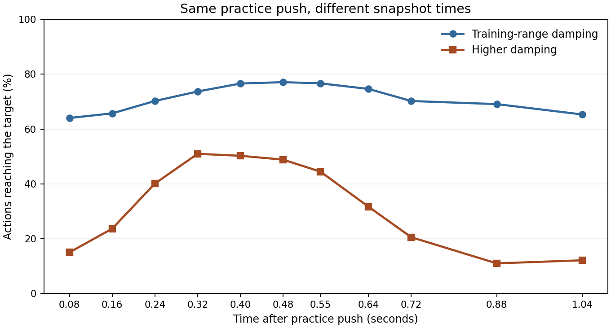

# #38 · 그네를 한 번 밀고 언제 사진을 찍을까?

익숙한 저항에서 관찰 시점을 미리 고를 때는 **0.48초**, 강한 저항의 행동 결과로 시간을 고를 수 있을 때는 **0.32초**가 선택됐다. 강한 저항의 새 확인 장면에서 기존 0.55초의 성공률 43.7%가 0.32초에서 51.3%로 올랐다.

## 이미 있던 실험과 이번에 바꾼 점

[이전 그네 실험](../damping_gate/README.md)은 약하게 한 번 밀고 0.55초 뒤에 찍었다. 목표 54도에서 그 사진의 픽셀이 똑같은 그네 두 개가 각각 3단과 4단을 요구했다. 0.24초에는 두 사진이 달랐다. 이번에는 한 쌍에서 발견한 단서가 여러 장면에서도 행동 선택에 도움이 되는지 시험했다.

| 역할 | 무엇을 하나 |
|---|---|
| 연습 동작 | 같은 출발점에서 약하게 한 번 밀고, 미리 정한 시점에 사진을 한 장 찍는다. 정책은 출발 사진과 그 한 장만 받는다. |
| 행동 선택기 | 사진 두 장에서 읽은 각도로 네 세기의 이후 움직임을 예상한다. 미래 다섯 시점의 예측 각도 중 가장 큰 값이 목표에 가장 가까운 세기를 고른다. |
| 물리 엔진 | 연습 전 위치로 되돌리고 선택한 세기로 민다. 실제 첫 최고점이 목표의 ±7.5도 안이면 성공이다. |

‘밀기’는 경첩 진자의 초기 각속도를 지정하는 조작이다. 연습은 2 rad/s, 본 행동은 2.4·3.3·4.2·5.1 rad/s다. 센 힘으로 다시 밀기 전에 항상 리셋한다. 기울기 25~45도에서 시작각은 −8~8도, 목표는 32~91도다. 원래 점성 감쇠율은 0.6~1.4 s⁻¹, 강한 감쇠율은 2.0~2.8 s⁻¹이다.

공개 Flow-JEPA Reacher의 고정 시각부와 기존 각도 판독기로 96×96 사진을 읽었다. 주 선택기는 감쇠를 생략한 운동식의 미래 각도 다섯 개를 회귀로 보정한다. 각 시점에 같은 학습 장면과 같은 회귀 설정을 사용하고, 시점별 예측기를 따로 맞췄다. 본 행동의 실제 최고점은 2 ms 간격 엔진 궤적으로 채점한다. 감쇠·기울기 정답은 선택기에 주지 않는다.

## 미리 고른 시점의 성적

원래 저항의 학습 시범은 독립 3묶음 × 2,048장면(장면마다 무작위 본 행동 하나)이다. 별도 768개 장면에서 11개 시점을 비교했다. 운동식 보정 회귀와 사진 각도 직접 회귀가 모두 0.48초를 골랐다. 기존 시간 이내로 제한해도 같은 선택이다. 이후 원래·강한 저항에 각각 같은 2,048개 출발 조건을 써서 비교했다. 표의 %는 학습 3묶음에서 얻은 성공률의 평균이다.

| 독립 시험 | 기존 사진 | 변경한 사진 | 성공률 차이와 동시 95% 구간 |
|---|---:|---:|---:|
| 원래 저항 | 0.55초 · 76.7% | 0.48초 · 77.1% | +0.4%p [-0.3, +1.2] |
| 원래 저항 | 0.55초 · 76.7% | 0.24초 · 70.2% | -6.4%p [-8.1, -4.8] |
| 강한 저항 | 0.55초 · 44.4% | 0.48초 · 48.8% | +4.4%p [+3.2, +5.7] |
| 강한 저항 | 0.55초 · 44.4% | 0.24초 · 40.1% | -4.3%p [-6.3, -2.4] |

강한 저항에서 0.48초는 사전에 정한 개선 기준(차이 ≥3%p, 구간 하한 >0)을 통과했다. 대기 시간은 0.07초 줄어서 시간 단축 기준(0.10초 이상)에는 미달했다. 0.24초는 두 범위에서 모두 성공률이 떨어졌다.

## 새 저항의 결과를 이용해 시점을 고른 경우

첫 강감쇠 시험 2,048개에서 네 본 행동의 성패를 보고 가장 성적이 좋았던 0.32초를 고정했다. 모델 가중치는 그대로 사용했다. 이 선택에는 강한 저항에서 각 본 행동이 성공했는지 알려 주는 자료가 필요하다. 독립적으로 뽑은 새 강감쇠 장면 2,048개에서 두 비교를 확인했다.

| 비교 | 성공률 변화 | 차이와 동시 95% 구간 | 덜 기다린 시간 |
|---|---:|---:|---:|
| 0.55초 → 0.32초 | 43.7% → 51.3% | +7.6%p [+6.2, +9.0] | 0.23초 |
| 0.48초 → 0.32초 | 49.0% → 51.3% | +2.3%p [+1.5, +3.2] | 0.16초 |

기존 시점 대비 개선·시간 단축을 모두 통과했다. 0.48초 대비로는 시간 단축을 통과했고, 성공률 증가폭은 사전에 정한 3%p에 못 미쳤다. 네 세기 중 하나라도 성공 가능한 장면은 1,060/2,048개(51.8%)였다. 그 장면에서 0.32초의 성공률은 99.1%였다.

탐색 대조로 첫 강감쇠 2,048개의 같은 성패 자료에서 목표각을 5도씩 묶고, 구간마다 가장 많이 성공한 세기를 외웠다. 새 확인 장면에서 **사진 없이 45.9%**, 0.32초 사진과 회귀로 **51.3%**였다. 차이는 5.4%p다. 목표만 쓰는 모든 방법에 대한 상한은 아니다. [목표별 힘 표](goal_control.json)

## 시점 전체와 사진에 남는 단서



| 연습 후 시간 | 원래 저항 검증 | 원래 저항 시험 | 강한 저항 첫 시험 | 강한 저항 직접 회귀 |
|---:|---:|---:|---:|---:|
| 0.08초 | 63.8% | 64.0% | 15.0% | 14.9% |
| 0.16초 | 65.8% | 65.7% | 23.6% | 20.0% |
| 0.24초 | 70.1% | 70.2% | 40.1% | 42.6% |
| 0.32초 | 75.4% | 73.7% | 50.9% | 50.9% |
| 0.40초 | 77.4% | 76.6% | 50.2% | 50.5% |
| 0.48초 | 78.3% | 77.1% | 48.8% | 48.7% |
| 0.55초 | 77.4% | 76.7% | 44.4% | 44.0% |
| 0.64초 | 76.2% | 74.6% | 31.6% | 30.1% |
| 0.72초 | 71.1% | 70.2% | 20.5% | 20.4% |
| 0.88초 | 68.7% | 69.1% | 11.0% | 10.9% |
| 1.04초 | 65.6% | 65.3% | 12.1% | 12.3% |

원래 저항 / 강한 저항 순서로, 연습 없이 출발 사진만 쓴 회귀는 64.1% / 15.0%, 시각을 균일하게 무작위로 골랐을 때의 기대 성공률은 71.2% / 31.7%였다. 첫 시험의 가능한 목표는 각각 1,609/2,048, 1,048/2,048개다.

같은 시점의 같은 픽셀을 받아야 하는 경우까지 따로 셌다. 출발각 3개, 정수 목표 60개, 각 저항 범위의 물성 81쌍을 균등하게 놓은 작은 격자에서, 강한 저항만 알 때 사진 한 장으로 달성할 수 있는 최고 성공률은 0.32초에 51.9%(7,562건), 0.55초에 51.9%(7,572건)다. 이 격자에서는 0.55초 사진으로도 도달 가능한 7,572건을 전부 맞힐 수 있다. 별도 무작위 시험에서 관찰된 성공률 차이의 원인은 이 계산만으로 가를 수 없다.

계산 근거는 간단하다. 출발각과 목표를 고정하면 같은 픽셀을 받은 모든 세계에서 정책은 한 행동을 골라야 한다. 각 픽셀 묶음에서 행동별 성공 건수를 세고 가장 큰 건수를 더하면 상한이다. 세계의 목록과 성공 여부를 아는 선택기는 묶음마다 그 행동을 골라 이 상한에 도달한다. 이 계산은 명시한 유한 격자와 분포에 한정된다. [격자별 건수와 반례](grid_bound.json)

## 한계와 다음 결정

고정 카메라의 합성 경첩 한 종류, 점성 저항 두 범위, 고정된 11개 시점, 한 번의 연습과 리셋을 시험했다. 같은 조건에서는 모든 장면에 같은 시점을 적용했다. 조기 사진의 효과는 학습된 선택기와 관측 조건을 함께 바꿀 때의 실측이다. 장면별로 저절로 시점을 고르는 능력, 센서 잡음·건마찰·실물 접촉으로의 전이, Flow 예측기의 고유한 이득은 미확인이다. 보정에 강감쇠 장면 몇 개면 충분한지도 미확인이다.

신뢰구간은 세 학습 결과를 장면별로 평균한 뒤 독립 시험 묶음 안에서 장면을 짝지어 64,000회 재표집한 값이다. 주 비교 여섯 개, 추가 확인 비교 두 개를 각각 Bonferroni 보정했다. 학습 자료를 다시 수집할 때의 변동은 이 구간에 포함되지 않는다. 가장 높은 시점을 최초 시험에서 찾은 값과 새 장면에서 확인한 값을 따로 보관했다.

추천은 0.48초를 새 저항의 결과가 없을 때 쓸 기준선으로, 0.32초를 강한 저항에서 보정한 기준선으로 두는 것이다. 다음에는 새 장치의 성공·실패를 몇 번만 보고 촬영 시간을 고를 수 있는지 측정할 만하다.

## 재현과 원자료

[첫 시험 계획](protocol.md) · [추가 확인 계획](confirmation_protocol.md) · [학습 범위 선택 기록](selection.json) · [강감쇠 선택 기록](strong_selection.json) · [첫 시험 전체](results.json) · [독립 확인](confirmation.json) · [이전 설치·가중치](../README.md#재현)

이 폴더의 train_*.npz, validation.npz, seen_*.npz, strong_*.npz, grid_*.npz에 시뮬레이터 궤적과 최고점을 보관했다. *_choices.npz에는 학습 묶음·시점·장면별 선택이 있다. policies.joblib는 고정한 예측기다. 시각부와 각도 판독기는 이전 실험과 공유한다. FM38_DATA 기본값은 E:/0.Project/fm38_visual이며, 별도 소스 위치는 FLOW_JEPA_SOURCE와 LEWAM_SOURCE로 지정할 수 있다.

이 폴더에서 [simulate.py](simulate.py)는 MuJoCo 환경, [policy.py](policy.py)는 기존 CUDA 학습 환경으로 실행한다. 순서는 아래와 같다. 저장 데이터에서 통계만 다시 낼 때는 시뮬레이션·학습·시점 선택을 생략할 수 있다. verify.py는 MuJoCo 환경으로 실행한다.

```text
simulate.py development → policy.py fit → simulate.py test → policy.py test → analyse.py
confirmation.py lock → simulate.py confirmation → policy.py confirmation → confirmation.py confirm
simulate.py grid → geometry.py
goal_control.py → report.py → verify.py → report.py --check
```
