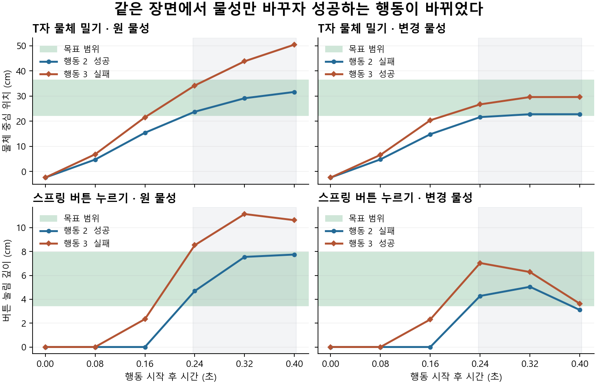

# #38 실험 결과 · 물성이 바뀌면 어떤 행동을 선택해야 하는가

**바닥 마찰과 버튼 강성을 바꾸자 같은 출발점에서 성공하는 행동이 뒤집혔다. 세 모델의 정책 점수 순위는 버튼에서 한 쌍만 사전 기준을 통과했다. 그 역전은 포기 보상과 접촉 성공을 읽는 방법에 민감했다.** 공 받기에서 보았던 ‘같은 모델의 공동 확률과 독립 곱 사이의 역전’은 두 새 과제에서 재현되지 않았다.

## 이미 있던 것과 이번에 만든 것

| 연구 자료 | 무엇을 확인하는가 |
|---|---|
| #38 원안과 이전 공 받기 검증 | 원안은 LeWM에 행동·flow·RoPE를 넣는 제안이었다. 공 받기에서는 상태값을 입력받는 소형 예측기의 공동 점수와 독립 곱을 비교했다. [원안 14행](https://github.com/duckychoi/note/blob/12fd6de97b79069c056b2d2cd658482ea290c62f/README.md#L14) · [공 받기 결과](../verification_20261123/README.md#38--같은-장면별-정확도에서-행동이-달라지는-조건) |
| 이번 물리·시각 시험 | 같은 출발점에서 네 행동의 실제 미래를 만들었다. 세 모델의 선택, 포기 여부, 물성에 따른 역전을 따로 기록했다. [사전 기준](protocol.md) · [물리 엔진](worlds.py) · [공개 모델 로더](public_model.py) · [세 방법](benchmark.py) · [집계](analyse.py) |
| 후속 검증 | 물성별 표지가 있을 때 실제 역전의 방향을 맞히는지, 접촉 성공을 읽는 방법을 바꾸면 결론이 유지되는지 새 시드로 검증했다. [물성별 보정 설계](calibration_protocol.md) · [판독기 비교 설계](readout_check.md) |

## 무엇을 고정하고 무엇을 바꿨나

| 역할 | 무엇을 하나 | 비유 |
|---|---|---|
| 물리 엔진 | MuJoCo에서 T자 물체의 바닥 마찰을 0.32~0.52 → 0.85~1.05, 별도 누르기 과제의 스프링 강성을 42~58 → 85~105 N/m로 바꾼다. 시작 자세·목표·행동은 물성 간 동일하다. | 같은 자리에 놓은 물체를 다른 바닥에서 같은 속도로 민다. |
| 공개 Flow-JEPA | 밀기는 저자 배포 Push-T, 누르기는 Cube 가중치로 시작한다. 시각 인코더·projector를 고정하고 예측기와 행동 인코더를 원 물성 시범으로 미세조정한다. 미래 다섯 장면을 8단계 적분으로 뽑는다. | 지금 사진을 보고 행동별 미래 영상을 여러 번 상상한다. |
| 혼합 예측기 | 같은 시각 표현에서 전체 미래 궤적을 4성분 대각 가우시안 혼합으로 학습한다. 한 표본의 다섯 장면은 같은 성분을 공유한다. | 한 가지 전개를 먼저 고르고 그 안에서 흔들림을 더한다. |
| 시범 검색 | 같은 행동을 했던 원 물성 시범에서 시작 이미지가 가까운 32개를 골라 실제 미래 임베딩을 읽는다. | 비슷한 장면에서 같은 힘으로 눌렀던 기록을 찾는다. |
| 성공 판독기 | 세 방법이 같은 판독기를 쓴다. 보이는 목표 띠와의 거리, 버튼에서는 접촉 여부까지 원 물성 훈련 영상과 시뮬레이터 표지로 학습한다. 시험의 정답은 엔진이 정한다. | 선수들은 같은 심판을 쓰고 실제 결과는 별도로 확인한다. |

고정 카메라는 물리 상태를 96×96 RGB로 평면 투영한다. 첫 화면에는 물성과 접촉 플래그가 표시되지 않는다. 각 과제의 원 물성 시범 2,048개는 시작점당 무작위 행동 하나다. 검증은 다른 192개 시작점, 주 시험은 384개 시작점 × 네 행동 × 두 물성이다. 동일 화면 확인 후 두 물성의 예측 표본까지 공유했다. 학습형 두 방법은 같은 3개 시드, 같은 미니배치 순서, 배치 48, 업데이트 500회 중 원 물성 검증 손실로 체크포인트를 선택했다. 검색은 결정적이다. 과제별 공통 시각부에 더해 Flow-JEPA의 예측부도 사전 학습되어 있다. 네 행동을 원 모델의 action block 길이에 맞는 정규화된 강도 지수로 넣었다. 저자 배포본의 동역학을 추가 학습하지 않은 전이 성능도 아래에 제시한다. [저자 코드](https://github.com/HuoYanchen/Flow-JEPA/tree/6b6a88b45a93ba1bcb2ce65af6c2003e771fe376) · [공개 체크포인트](https://huggingface.co/HuoYanchen/Flow-JEPA)

모든 방법은 후보당 32개 미래와 결정당 1초 상한을 받았다. RTX 5090에서 미리 렌더링한 한 장면을 전처리하고 네 행동을 비교해 CPU로 선택을 돌려줄 때까지 측정했다. 워밍업 후 24회 p95는 밀기에서 Flow 72.5 ms / 혼합 11.9 ms / 검색 12.1 ms, 누르기에서 65.9 / 6.4 / 6.4 ms였다. 기록한 모든 호출이 상한 안에 들었다. 표본 수와 허용 시간이 같아도 실제 계산량·훈련 이력은 다르다. [밀기 측정](push_run.json) · [누르기 측정](press_run.json)

## 행동 자체의 순위

한 시작점에 대해 행동 A 성공·B 실패가 변경 물성에서 A 실패·B 성공으로 바뀌면 엄격한 역전으로 셌다. 성공 동률은 제외했다. 한 장면에 네 행동이 있어 여섯 쌍이 생긴다.

| 실제 결과 | 원 물성 → 변경 물성 | 한 쌍 이상 뒤집힌 장면 | 뒤집힌 행동쌍 |
|---|---|---:|---:|
| 밀기 | 전체 장면 평균 성공률이 가장 높은 행동이 속도 1.45 → 1.90 m/s로 바뀜 | 60/384 = **15.6%** (95% 구간 12.3~19.6%) | 97/2,304 |
| 누르기 | 전체 평균 1위는 3.60 N으로 유지. 개별 목표에서 성공하는 힘은 바뀜 | 16/384 = **4.2%** (2.6~6.7%) | 23/2,304 |

밀기 11번 장면은 마찰 0.47 → 1.00에서 같은 속도 1.45 m/s의 결과가 성공 → 실패, 1.90 m/s는 실패 → 성공이었다. 목표가 같아도 미끄러지는 거리가 달라진다. 아래 음영 시간의 세 점이 모두 녹색 범위 안에 있어야 한다. 누르기는 세 시점 모두 실제 접촉까지 필요하다.



## 모델이 실제로 선택한 행동의 가치

성공 1점, 실패 0점이다. 포기 보상이 0.1, 0.3, 0.5, 0.7일 때 각각 결정을 시키고 네 점수를 평균했다. 항상 포기하면 0.400이다. 다음 표는 한 예측 궤적에서 마지막 세 장면이 모두 성공한 비율로 행동을 고른 결과다. 괄호는 포기를 허용하지 않고 최고 점수 행동을 강제로 시켰을 때의 성공률이다.

| 방법 | 밀기 원 물성 → 고마찰 | 버튼 원 물성 → 단단한 스프링 |
|---|---:|---:|
| 미세조정 공개 Flow-JEPA | 0.4224 → 0.4298 (18.8% → 25.1%) | 0.4000 → 0.4000 (4.3% → 0.3%) |
| 혼합 예측기 | 0.4204 → 0.4204 (18.4% → 18.8%) | 0.4081 → 0.3998 (17.8% → 6.1%) |
| 시범 검색 | 0.4281 → 0.4176 (21.9% → 19.0%) | 0.4462 → 0.3342 (28.6% → 11.5%) |
| 공개 예측부 그대로, 공유 판독기 적용 | 0.3999 → 0.3999 | 0.4000 → 0.4000 |
| 원 물성 검증에서 정한 상수 행동·포기 정책 | 0.4336 → 0.4297 | 0.4466 → 0.4036 |
| 엔진 정답을 미리 본 선택의 상한 | 0.6375 → 0.7391 | 0.7438 → 0.4859 |

방법 간 3쌍과 방법별 두 채점 방식 3쌍에 두 과제·두 물성을 곱한 24개 차이를 한 검정 가족으로 삼았다. 시드별 정책 가치를 시작점별로 평균한 뒤 같은 시작점을 짝지어 64,000번 재표집하고 Bonferroni 보정한 백분위 구간을 사용했다. 양쪽 구간이 0을 제외하고 부호가 반대일 때만 확인으로 판정했다. 구간은 주어진 훈련 시범·시험 물성 범위에서 시작점이 바뀌는 불확실성을 나타낸다. [정확한 차이·구간·시드별 점수와 비용별 시도율](results.json)

**모델 사이**에서는 버튼의 Flow−검색 한 쌍이 통과했다. 원 물성에서 −0.0462 [−0.0868, −0.0064], 변경 후 +0.0658 [+0.0372, +0.0922]였다. Flow는 세 시드에서 모든 버튼 누르기를 포기했다. 검색은 단단한 버튼에서도 가장 낮은 포기 보상에서 99.2% 시도했다. 강제 행동으로 비교하면 검색의 성공률이 두 물성 모두 더 높다. 밀기에서는 검색 1위 → Flow 1위로 표본 평균이 바뀌지만, Flow−검색 구간은 양쪽 모두 0을 포함했다.

**한 모델 안**에서는 32개 예측의 세 장면 성공 표시를 H₁,H₂,H₃라 했다. 공동 점수는 각 표본에서 H₁H₂H₃를 구한 뒤 평균한다. 독립 곱은 같은 표본에서 각 장면의 평균을 구한 뒤 세 수를 곱한다. 두 점수는 같은 장면별 성공률을 사용한다. 공동−독립이 물성 전후 유의하게 뒤집힌 경우는 여섯 비교 중 0개였다. 단단한 버튼에서 검색은 공동 0.3342, 독립 0.3715로 공동 쪽이 낮았다. 원 스프링에서 두 방식 간 차이는 −0.0061이고 구간이 0을 포함했다.

## 물성이 달라진 사실을 모델이 알아챌 수 있나

같은 입력 영상 x와 행동 a에 같은 예측 표본을 쓰면 점수 s(x,a)도 같다. 두 물성에서 A와 B의 실제 우열이 반대일 때 고정된 엄격한 순서 하나는 두 경우를 모두 맞힐 수 없다. 주 시험은 이때 선택의 **실제 손익**을 측정한다. 추가 시험에서는 물성별로 64개 시작점 × 네 행동의 성공 표지를 제공해 각 행동 확률의 log-odds에 보정 상수 하나를 학습했다. 어느 물성의 보정을 사용할지는 알려줬다. 주 시험과 독립인 새 256개 시작점에서 확인했다. [보정 코드](calibrate.py) · [모든 시드 결과](calibration.json)

| 방법 | 밀기 실제 역전 75쌍 중 올바른 방향까지 맞힌 수 | 누르기 실제 역전 5쌍 중 적중 |
|---|---:|---:|
| Flow-JEPA | 23~33쌍 / 75 | 0/5 |
| 혼합 예측기 | 26~29쌍 / 75 | 0~1/5 |
| 시범 검색 | 31/75 | 1/5 |
| 물성별·행동별 성공 빈도만 사용 | 15/75 | 0/5 |

검색은 밀기에서 606쌍의 역전을 예고해 31쌍(5.1%)만 실제 방향까지 맞혔다. 동률이 되는 사례도 실패로 셌다. 이 자료에서 실제 엄격한 역전 자체의 빈도는 75/1,536 = 4.9%였다. 방법별 적중 개수가 단순 빈도보다 많아도 장면별 역전을 믿고 행동할 수준의 정밀도를 보여 주지는 못했다. 버튼은 실제 역전이 5쌍이어서 방법 간 우열을 정하기 어렵다.

## 접촉을 읽는 단계의 영향

주 시험의 실제 단일 미래 화면에서 기존 판독기의 균형 정확도(성공과 실패를 맞힌 비율의 평균)는 밀기 90.4% → 93.2%, 버튼 72.5% → 72.7%였다. 그러나 **실제 세 장면을 모두 준 경우에도** 단단한 버튼의 연속 성공을 맞힌 비율은 8.8%였다. 이때 정확도 94.1%는 실패 사례가 많은 데 따른 값이다. 혼합 예측기의 원 물성 검증 유효 성분 수(1/∑w²의 상태 평균)는 밀기 2.53~2.83, 버튼 1.59~1.86이었다. [판독·혼합 성분 진단](diagnostics.json)

이 결과를 본 뒤 버튼용 새 판독기를 원 물성 시범으로만 학습했다. 세 장면의 표현을 한꺼번에 보고 성공을 판정한다. 주 시험·보정 시험과 별개인 **새 384개 시작점**에서 두 판독기에 같은 예측 궤적을 줬다.

| 새 버튼 시험 | 한 장씩 판정 후 세 번 모두 성공 | 세 장을 함께 보는 판독기 |
|---|---:|---:|
| 실제 원 물성 영상의 성공 검출률 / 실패 검출률 | 39.1% / 89.1% | 87.4% / 64.3% |
| 실제 단단한 버튼 영상의 성공 검출률 / 실패 검출률 | 3.3% / 98.1% | 30.4% / 79.9% |
| Flow 행동 가치, 원 → 변경 | 0.4000 → 0.4000 | 0.3633 → 0.3423 |
| 혼합 행동 가치, 원 → 변경 | 0.4140 → 0.3999 | 0.3503 → 0.2242 |
| 검색 행동 가치, 원 → 변경 | 0.4243 → 0.3351 | 0.3164 → 0.1608 |

새 384개 장면에서는 기존 판독기의 Flow−검색 차이가 −0.0243 [−0.0563, +0.0071] → +0.0649 [+0.0410, +0.0874]였다. 평균의 방향은 같았으나 원 물성 우위까지 독립 확인하지 못했다. 대괄호는 이 추가 시험의 네 차이에 보정한 동시 구간이다.

새 판독기는 단단한 버튼에서 실제 성공을 더 많이 찾고 실패도 더 자주 성공으로 읽었다. 그 결과 검색의 시도율은 네 포기 보상 평균 51.4% → 90.6%가 됐다. 이 판독기로는 Flow−검색 평균 차이가 +0.0469 [−0.0049, +0.0976] → +0.1815 [+0.1489, +0.2123]으로 바뀌어 평균 순위의 역전도 사라졌다. Flow의 절대 점수는 두 물성 모두 항상 포기하는 0.400보다 낮다. 이 민감도 시험은 주 시험 뒤에 설계했으며 두 판독기에 정확히 같은 궤적 표본을 적용했다. [새 시험의 점수·판독 정확도와 구간](readout_check.json) · [코드](readout_check.py)

## 연구 판단과 한계

두 과제에서 물성 변화가 야기한 행동 역전은 측정할 수 있었다. 모델 간 점수 역전에는 성공 희소성, 포기할 때 받는 보상, 시각 판독의 실패가 함께 작용했다. 모델의 물리 예측 능력을 주장하려면 실제 성공과 포기, 실제 미래 영상에 대한 판독 오류, 반드시 행동할 때의 순위를 함께 공개해야 한다. 특히 버튼에서는 간단한 원 물성 상수 정책이 새 물성에서 세 모델의 평균 점수 이상이었다.

과제는 평면 RGB 렌더링과 네 가지 미리 정한 행동으로 만든 0.4초짜리 한 번 선택이다. 하나의 정지 화면으로는 배경에 숨겨진 마찰이나 강성을 구별할 수 없다. 물성 범위마다 이산값 9개를 사용했고 세 학습 시드가 같은 시범 집합을 봤다. GPU 지연은 표본 관측치이며 훈련 FLOP와 사전학습량을 맞추지는 않았다. 저자의 원래 Push-T·OGBench-Cube 성능, 실제 로봇, 장기 폐루프 조작으로 일반화하는 근거는 별도로 필요하다.

**추천**은 #38을 물성 변화에서 행동 점수를 검증하는 연구로 유지하고, 다음 관문으로 같은 약한 밀기·누르기를 한 번 먼저 실행해 그 응답 영상까지 보는 조건을 사전 지정하는 것이다. 초기 접촉의 변위나 미끄러짐을 봤을 때 같은 시범·행동·시간 예산으로 무조건 포기 및 물성별 단순 빈도보다 실제 선택이 좋아지는지 묻는다. 현 단계에서 상위 AI 학회 본회의에 낼 일반 알고리즘 우위나 새로운 구조의 근거는 부족하다.

## 재현

결과 폴더에서 아래 명령을 실행한다. 첫 줄은 함께 보관한 시험별 예측과 엔진 정답만으로 주 표·통계 구간을 재생성한다. 재집계 결과가 처음 생성한 JSON과 바이트 단위로 일치함을 확인했다.

```powershell
python analyse.py --from-archive
```

전체 재현에 쓴 환경은 MuJoCo 4.0.1, PyTorch 2.11.0+cu128, Transformers 5.5.4, NumPy 2.4.4, SciPy 1.17.1, Pillow, einops, matplotlib와 CUDA GPU다. 물리 데이터 생성은 MuJoCo가 설치된 Python, 그 밖의 명령은 PyTorch가 설치된 Python에서 실행할 수 있다. 기본 데이터 폴더는 E:/0.Project/fm38_visual이며 FM38_DATA 환경 변수로 바꿀 수 있다. FLOW_JEPA_SOURCE는 저자 코드 체크아웃 경로다. 기본값은 작업공간의 research-sources/Flow-JEPA이다. 소스 커밋은 6b6a88b45a93ba1bcb2ce65af6c2003e771fe376, 가중치 배포 버전은 f26a1a5f3d1e0aeeb68377a7e7463088f244c79c이다. 로더는 두 가중치의 SHA-256을 확인하고 설치된 Transformers판의 ViT 층 이름을 일대일 대응시킨 뒤 전체 키와 크기를 엄격히 검사한다.

```powershell
python worlds.py
python public_model.py --download
python benchmark.py
python analyse.py
python diagnostics.py
python worlds.py --calibration
python calibrate.py
python worlds.py --readout-check
python readout_check.py
python figure.py
```
