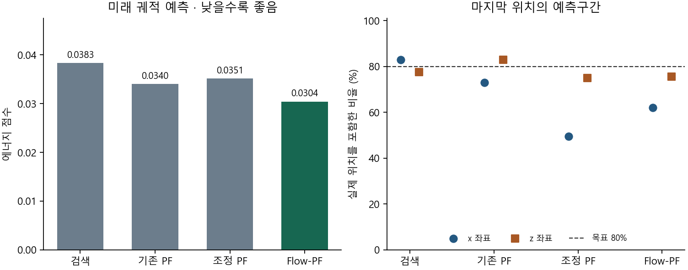

# #36 · 학습한 출발 입자와 물리 시뮬레이션의 독립 검수

기존 여섯 조합은 문서에 정한 5차 관문을 통과했다. 원 시험의 주 분배 세 모델은 저장 가중치에서 재추론했다. 새 사례에서는 조정한 검색과 입자가 많은 PF를 각각 비교했다. 에너지 점수는 미래 위치 예측 분포를 채점하며 낮을수록 좋다.

## 기존 기록과 회계

| 분배 | 에너지 평균 ± 학습 3회 표준편차 | 같은 예산 검색 대비 감소 | x / z 포함률 | 통과 |
|---|---:|---:|---:|---:|
| 주 | 0.04166 ± 0.00188 | 21.7% | 67.4% / 70.5% | 3/3 |
| 보조 | 0.04030 ± 0.00086 | 24.3% | 71.9% / 76.2% | 3/3 |

같은 배정 예산의 기본 PF는 0.08858, 재조정한 검색은 0.05324, 검색으로 출발점을 제안하는 PF는 주 분배 0.05219, 보조 분배 0.05101를 기록했다. 큰 PF는 0.04345였다. 원 시험 묶음을 재생한 주 모델의 에너지 최대 오차는 0였다. 보조 모델은 가중치가 보관되지 않아 네 시험 묶음별 로그로 검산했다.

주 모델 하나에 배정한 궤적 수는 147,456 + 192 × 256 = 196,608, 보조 모델 하나는 98,304 + 192 × 512 = 196,608다. 큰 PF는 192 × 8,192 = 1,572,864다. 한 모델의 배정 궤적 수만 큰 PF보다 적어지는 최소 적용 건수는 주 분배 19건, 보조 분배 13건이다. 이 비율은 고정한 한 모델을 192사례에 적용할 때의 궤적 예산이다. 실제 원 스크립트는 공용 준비에서 넓은·좁은 사전 라이브러리를 각각 196,608개 생성했다. 학습에 사용한 궤적만 모델에 배분했다. 검증, 최적화 시간, 비교 방법들의 재실행을 합친 총 작업량이나 실측 속도는 별도다.

학습 설정 변경 후보는 분리 검증에서 6개 중 2개를 이겨 기각됐다. 기존 시험 4묶음은 앞선 관문과 같다. 여러 학습 시드가 하나의 넓은 학습 라이브러리와 시험 사례를 공유하므로 24번의 독립 성공으로 셀 수 없다.

4b에서 실패했던 학습 시드(61098)를 그대로 쓰고, 같은 학습 자료와 검증 규칙으로 다시 비교했다. 인내값 5 → 15에서 실제 학습은 14 → 60에폭, 최저 검증 손실은 1.077 → -1.900, 기존 192사례의 에너지 점수는 0.05729 → 0.03982였다. 검증이 고른 PF 온도도 4에서 1로 바뀌었다. 원 로그의 실패 실행은 14에폭, 에너지 0.05729였다. 두 재학습의 공통 구간에서 매 에폭 훈련·검증 손실이 일치했다. 이 대조는 해당 학습 시드에 한정한다. [학습 곡선](patience.json)

원래 관문 3 전체를 단독 실행할 때의 재현 오류도 확인했다. pf36_g3.py의 library()는 현재 다섯 값을 반환하지만 main()은 좁은 라이브러리를 두 값으로 풀어 받는다. 작은 입력에서도 ValueError가 재현됐다. 해당 줄에서 첫 번째 위치 배열만 선택하면 된다. 이번 감사의 기준 PF는 같은 파일의 run_pf_full()을 직접 호출했다. [반환부](../pf36_g3.py#L93) · [호출부](../pf36_g3.py#L297)

## 새 시험과 공정한 기준 PF

원래 환경 생성기에서 새 난수 8묶음 × 24사례를 생성했다. 주 분배 세 모형의 가중치와 검색 설정은 고정했다. 기존 PF-8192는 PF-1024로 고른 온도 4를 물려받았다. 검증 48사례로 입자 8,192개에 맞춰 다시 골랐을 때 온도는 1였다. 온도는 관측 오차를 얼마나 강하게 반영할지 정한다. 실제 새 시험 전에 고정했다.

| 새 192사례에서의 방법 | 에너지 | 마지막 x / z의 80% 예측구간 포함률 |
|---|---:|---:|
| 재조정한 검색 | 0.03833 | 82.8% / 77.6% |
| 기존 PF-8192 | 0.03403 | 72.9% / 82.8% |
| 입자 수에 맞춰 조정한 PF-8192 | 0.03515 | 49.5% / 75.0% |
| Flow-PF 주 분배, 세 모델 평균 | 0.03043 | 62.0% / 75.5% |

| 새 시험에서 요구한 성능 | 통과선까지 여유 (양수면 점 추정 통과) | 세 비교 동시 95% 구간 | 판정 |
|---|---:|---:|---|
| 검색보다 5% 이상 낮음 | +0.00598 | [-0.00007, +0.01203] | 미확정 |
| 기존 큰 PF 대비 5% 이내 | +0.00529 | [+0.00088, +0.00971] | 통과 |
| 조정 큰 PF 대비 5% 이내 | +0.00647 | [+0.00209, +0.01086] | 통과 |

세 모델 평균이 검색보다 낮은 시험 묶음은 7/8개다. 평균 점수 변화는 검색 대비 -20.6%, 기존 큰 PF 대비 -10.6%, 조정 큰 PF 대비 -13.4%다. 기준에 비율을 곱한 뒤 같은 묶음에서 Flow 점수를 뺀 차이로 구간을 구했다. 8묶음 t 구간은 근사치이며 세 고정 가중치를 다시 학습할 때의 변동까지 보장하지 않는다.

## 과신의 원인과 이론

기존 주 모델의 x 포함률은 검증 70.1%에서 시험 67.4%로, z는 78.5%에서 70.5%로 바뀌었다. 검증에서도 x는 80%보다 낮다. 이 구간은 모형이 공의 마지막 위치에 대해 내놓는 예측구간이다.

| 별도 짝 시험 | 안쪽 물성 → 바깥 물성의 포함률 | 바깥−안쪽 차이와 두 좌표 동시 95% 구간 |
|---|---:|---:|
| x | 61.6% → 62.0% | +0.3%p [-6.0, +6.7] |
| z | 76.0% → 75.5% | -0.5%p [-10.1, +9.0] |

짝 시험은 동일한 초기 상태, 관측 잡음, 누락 및 바운스 난수열을 사용하고 마찰·댐핑의 분포만 바꿨다. 두 좌표의 포함률 차이 구간은 0을 포함하므로 이 표본에서는 감소도 증가도 확정되지 않았다. 안쪽 물성에서도 x의 과신이 남았다. 두 물성을 함께 바꿔 각 물성의 효과는 나누지 않았다. 학습·추론은 넓은 범위의 이산 물성 144쌍을 사용하고, 시험값은 그 범위 안에서 연속으로 생성한다. 좁은 검증 범위를 벗어나지만 넓은 학습 범위 안의 격자 사이에서 평가한 것이다. 좁은 범위에서만 시뮬레이션해 학습한 기존 두 모델은 실패했다.

앞부분의 관측과 누락 마스크를 보고 flow가 시작 상태와 물성 후보를 낸다. 초기 가중치에는 사전밀도를 실제 제안 혼합밀도로 나눈 비율이 들어가고, 물리 엔진으로 생성한 관측 우도를 곱한다. 초기 가중식과 RealNVP 밀도의 변수변환은 맞다. 이후 입자 위치를 흔들고 물성 격자를 이동시키는 단계에는 정확한 사후분포로 돌아가는 보정이 없다. 5차 관문은 에너지 기준이고, 앞선 연구 목표의 포함률 범위와 두 번째 환경은 별도다.

## 연구 판단과 증거

동일 궤적 예산의 검색을 상대로 관측을 이용해 출발 입자를 고르는 방법을 계속 검토할 가치가 있다. 같은 조건부 가우시안·혼합밀도 제안, 총실행 시간, 두 번째 환경, 최신 직접 대조가 남는다. FPPF는 조건부 생성 제안과 중요도 보정을 사용하고 LD-EnFF는 잠재 공간에서 순차 갱신을 수행한다. 초기 제안이라는 구조의 선행성 및 SOTA 우위는 이 비교로 입증되지 않았다. [FPPF](https://arxiv.org/abs/2607.01012) · [LD-EnFF](https://arxiv.org/abs/2610.04034)

[기존 계획](../PREREG.md) · [원래 결과](../RESULT.md) · [독립 계획](protocol.md) · [물성 짝 시험 계획](coverage_protocol.md) · [새 기준 PF 검증 점수](pf_selection.json) · [원 시험 재실행](replay.json) · [전체 집계](audit.json)

MuJoCo·torch 환경에서 replay.py, fresh.py, coverage_pair.py, patience.py로 실행한다. fresh_*.npz와 inner_*.npz에는 시험 정답·관측 및 사례별 점수가, primary_replay.npz에는 기존 주 가중치의 재평가가 있다. 보고서는 report.py로 재생성한다. report.py --check는 원자료와 저장 보고서의 일치를 검사한다.
