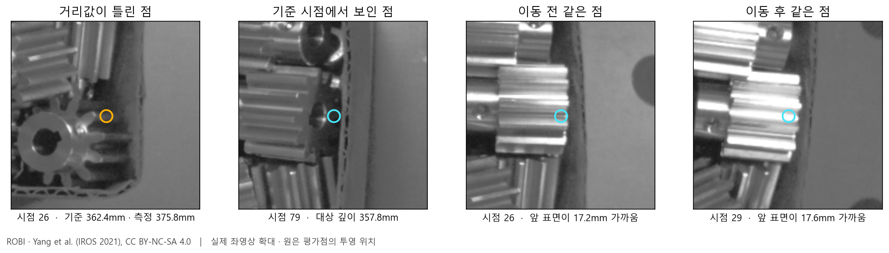

# #43 공개 실측 관문과 #63 관측 품질 진단

**2026-11-24. 두 장비에서 깊이 정확도를 유지하며 55% 규칙보다 총 측정 시간을 20% 이상 줄였다는 주장은 입증되지 않았다.** RealSense에서는 불필요한 거리점 질의를 줄일 수 있었다. Ensenso에서는 추가 촬영이 모든 시험 출발점에서 빈 깊이를 채웠다. 더 가까운 순번의 시점을 쓰면 평균 이동 변위가 25.9% 작아졌지만, 같은 시점을 55% 규칙에도 줄 수 있다. 현재 결과가 지지하는 것은 장비별 행동을 단순화할 근거다. [기존 Middlebury 결과](../post38_decision_20261124/RESULT.md) · [사전에 정한 조건 및 사후 탐색 구분](PROTOCOL.md)

## 실제 자료와 비교 방법

ROBI의 산업용 Ensenso N35와 Intel RealSense가 로봇 팔에서 실제로 찍은 크롬 나사와 기어를 사용했다. 각 물체에서 코팅 기준 깊이가 모든 Ensenso 시점에 있는 장면 4·5·8·9를 택했다. 장비별·장면별 초기 자세 두 개씩, 총 32개의 초기–이동 쌍이다. 나사 장면 4·8에서 후보를 정하고 5·9에서 시험했다. 기어 네 장면에는 나사의 문턱을 그대로 적용했다. 따라서 **모델 선택에 쓰지 않은 시험은 장비당 12회, 물리적 장면 여섯 배치**다. 두 물체의 로봇 촬영 경로는 대부분 겹친다. 이 숫자를 독립적인 로봇 경로 수로 세지 않는다. [ROBI 자료·라이선스](https://www.trailab.utias.utoronto.ca/robi) · [저자 도구와 GT 범위](https://github.com/junyang224/ROBI_Toolkit#ground-truth-depth-map-in-robi)

| 역할 | 실제로 사용한 정보 |
|---|---|
| 55% 규칙 | 초기 좌우 패턴 영상 전체에서 스테레오 매칭에 성공한 비율이 55% 미만이면 추가 사진, 그 이상이면 독립 거리점 한 개를 선택한다. |
| 생략 후보 | 처음 얻은 장비 고유 깊이맵의 중앙에서 값이 나온 비율이 충분하면 종료한다. 나머지는 55% 규칙을 따른다. 개발 결과 RealSense 문턱 90%, Ensenso는 항상 기존 규칙을 따르게 됐다. |
| 추가 거리점 | 초기 영상만 보고 한 위치를 고른다. 공통 좌표에 등록한 다른 장비의 실제 깊이에서 그 위치의 값 하나만 반환해 전체 배율을 고친다. 답이 없으면 배율을 유지하고 시도 횟수는 청구한다. 공개 자료에서는 다른 장비가 이미 전체 프레임을 찍었다. |
| 추가 사진 | 같은 장비의 새 시점에서 실측한 깊이를 첫 카메라 좌표로 옮겨 원래 비었던 곳에 채운다. 두 정책 모두 같은 점·후처리·추가 시점을 쓴다. |
| 채점 | 코팅한 Ensenso 깊이를 공개 자세로 투영하고 가장 앞에 있는 표면을 남긴다. 초기 카메라 중앙 격자에서 질의 근방을 제외한다. 모든 방법에 동일한 기준점·분모를 쓴다. 미반환에 100mm를 청구한 평균 손실과 실제 반환 면적을 함께 본다. |

기존과 같은 SGBM 블록과 유일성 설정에 장비별 시차 범위를 적용했다. 공개 예제의 RealSense 시차 이동 부호를 그대로 쓰자 나사 공동 유효점 중 약 1%만 장비 깊이에서 2픽셀 이내였다. 실제 패턴 BMP에 맞는 −78픽셀로 수정했다. 최종 두 물체에서 시차 절대차 중앙값은 0.19–0.28픽셀이고 2픽셀 이내는 Ensenso 86.9–95.8%, RealSense 97.1–99.1%다. 임의 영역을 잘라 문턱을 맞추지 않았다. 시차 검색 탓에 매칭 가능한 가로 폭의 비율 자체가 Ensenso 약 72.5%, RealSense 87.5%다. 같은 55%가 두 장비에서 다른 의미를 가질 수 있다. [매칭·정책 코드](replay.py) · [저자의 좌우 영상 예제](https://github.com/junyang224/ROBI_Toolkit/blob/main/read_pattern_imgs.py)

## #43 행동 재생 결과

| 장비·시험 | 55% → 생략 후보 | 유효 깊이만의 평균 절대오차 | 기준 표면 중 값이 나온 비율 | 미반환 포함 평균 손실 |
|---|---|---:|---:|---:|
| Ensenso 나사 | 추가 사진 4 → 4 | 0.93 → 0.93mm | 86.88 → 86.88% | 13.916 → 13.916mm |
| Ensenso 기어 | 추가 사진 8 → 8 | 0.82 → 0.82mm | 87.62 → 87.62% | 13.084 → 13.084mm |
| RealSense 나사 | 거리점 시도 4 → 0 | 3.76 → 3.42mm | 95.61 → 95.61% | 7.975 → 7.653mm |
| RealSense 기어 | 거리점 시도 8 → 6 | 3.85 → 3.84mm | 91.39 → 91.39% | 12.120 → 12.106mm |

행은 출발점별 평균을 같은 비중으로 합친 값이다. 나사 RealSense 개선의 대부분은 장면 9, 기어의 깊이 개선은 장면 5 한 출발점에서 나왔다. 두 정책의 피복률이 각 출발점에서 같아 미반환 벌점을 25·100·250mm로 바꿔도 양쪽 손실의 차이는 같다. **가장 싼 대조군**인 RealSense의 ‘항상 첫 화면으로 끝내기’는 기어에서 점 시도 0회, 같은 피복률 91.39%, 손실 11.917mm였다. 후보의 6회·12.106mm보다 유리하다. 나사 시험에선 이 두 방식이 같다. 반대로 RealSense가 항상 추가 사진을 찍으면 기어에서 피복률 96.91%, 손실 7.322mm까지 좋아진다. 다른 정확도 목표를 두면 최선 행동도 달라질 수 있다. [나사 행동별 원자료](replay.json) · [기어 전이 원자료](gear_replay.json)

**Ensenso에서 생략으로 얻을 수 있는 범위.** 시험 출발점 12개 모두 사진이 첫 깊이보다 표면을 더 채웠다. 증가 폭은 출발점별 1.99–11.84%p다. 거리 한 점은 공통 배율만 바꾸므로 채우는 면적이 처음과 같다. 각 출발점의 가능한 최대 피복률을 이미 55% 규칙이 얻었다. 같은 세 행동에 같은 후처리를 쓰면서 평균 피복률을 유지한다면, 정답을 미리 아는 선택기도 12회 중 한 번도 사진을 생략할 수 없다. 이는 이 표본과 이 행동 목록에 대한 결과다.

**Ensenso에서 이동 위치를 바꾼 후속 탐색.** 나사 개발 장면에서 +1·+2·+3 순번 후보에 같은 오차·피복·회전 제약을 적용하자 고정 +1 순번이 선택됐다. 개발에 쓰지 않은 나사에서 평균 직선변위 208.9 → 154.8mm, 회전각 30.38 → 22.53도, 피복 86.88 → 89.64%, 손실 13.92 → 11.06mm였다. 기어에서는 변위 208.9 → 154.8mm, 회전각 30.38 → 22.53도, 피복 87.62 → 89.39%, 손실 13.08 → 11.28mm였다. **평균 변위 감소 약 25.9%**는 고정 촬영 위치를 변경한 효과다. 개별적으로 나사 장면 9 시점 17에서는 피복과 오차가 모두 나빠졌다. +1 순번의 변위가 +3보다 122mm 더 길어진 출발점도 있다. 55% 규칙에 같은 +1 위치를 주면 이 이동 정책과 Ensenso의 선택·깊이는 같다. [이동 비교](short_view.json) · [기어 이동 비교](gear_short_view.json)

**실제 시간 20%의 판정.** 두 원본 ZIP의 파일 목록 11,398개와 11,386개를 확인했다. 행동 재생에 사용한 깊이/자세 JSON은 물체당 84개이며 실제 필드는 카메라 자세와 물체 가시도다. 독립 점 명령의 시작·반환, 자세 변경 명령·정착·프레임 반환의 짝지은 시간이 없다. 비교 가능한 공개 대안도 살폈다. DARP에는 동기화한 로봇 관절 기록이 있지만 그 기록의 두 RealSense와 물체로 ROBI의 독립 점 질의·기준 표면을 복원할 수 없다. DMEB는 다중 깊이 센서와 프레임 시각이 있는 노출 실험이다. [나사 입력 해시](robi_inputs.json) · [기어 입력 해시](gear_robi_inputs.json) · [DARP](https://arxiv.org/abs/2608.31002) · [DMEB](https://divisonofficer.github.io/dmeb/)

예를 들어 최초 촬영·공통 처리에 회당 A초, 독립 점을 실제로 한 번 시도하는 데 P초가 들고 후보 계산비가 같다고 가정한다. RealSense 나사에서는 4A ≤ 0.8(4A+4P), 즉 P ≥ A/4여야 한다. 기어에서는 8A+6P ≤ 0.8(8A+8P), 즉 P ≥ 4A여야 한다. 최초 촬영 1초라면 기어에서는 점 한 번이 적어도 4초여야 한다. 추가 연산비가 있으면 필요한 시간이 더 길어진다. 실패·성공의 시간이 다르면 실제 생략된 두 건의 소요시간을 따로 알아야 한다. 이 식은 필요한 조건이며 실제 센서 시간 추정값이 아니다.

## 틀린 거리와 지속 가림이 실제로 있는가

부품 CAD 표면을 고정 난수로 면적에 따라 10만 점 표본화했다. 코팅 기준 깊이로 복원한 점이 자세를 적용한 CAD 표면 샘플과 1mm 이내인 경우만 부품으로 분류했다. 추가로 코팅 기준 주변 3×3이 모두 있고 가장 깊은 곳과 얕은 곳의 차가 3mm 이하인 표면에 한정해, 경계에 걸친 잘못된 대응의 영향을 줄였다. 지속 가림은 별도 제3 시점에서 보이는 같은 CAD 근접점을 양쪽에 투영해, 두 시점 모두 3×3에서 가장 먼 기준 표면보다도 10mm 넘게 뒤에 있을 때만 센다. [표면 검산 코드](surface_check.py) · [나사](surface.json) · [기어](gear_surface.json)

| 물체·장비 | 매끄러운 부품 기준에서 10mm 넘게 틀린 점 / 비교 가능점 | 이동 전후 모두 가려진 부품점 / 양쪽 비교 가능점 |
|---|---:|---:|
| 나사 Ensenso | 7 / 6,644 | 279 / 15,496 |
| 나사 RealSense | 55 / 5,382 | 36 / 9,488 |
| 기어 Ensenso | 7 / 8,231 | 796 / 17,968 |
| 기어 RealSense | 77 / 4,802 | 115 / 12,311 |

아래는 실제 Ensenso 좌영상이다. 주황색은 기준보다 13.44mm 멀게 측정한 기어 점이다. 파란색은 기준 시점에는 보이고 이동 전후에는 다른 표면 뒤로 각각 17.18mm·17.59mm 숨은 별도의 기어 점이다. 이 깊이 차이는 센서 미반환만 보고 내린 판정과 구별된다. 비반사 코팅 전후의 반복 스캔과 캘리브레이션에는 오차가 있어 개별 거리 오차 전부를 반사 하나에 귀속할 수 없다. 표의 픽셀은 반복된 관측이며 독립 장면 수가 아니다. [사진의 좌표·실제 깊이](gear_examples.json)



## #63 원래 질문과 시험 결과

최초 개념노트와 연구 원장은 교수님의 질문을 **예측 오차와 별도로, 지금 이 관측 자체가 얼마나 믿을 만한지 알 수 있는가**로 기록한다. 텔레그램 원문 전체는 확보하지 못했다. 이전 HAPT 시험은 이후 프레임을 기다릴 때 두 원인이 구별되는 조건을 보였다. 이번에는 원래 질문으로 돌아가 현재 프레임만 가지고 실제 거리 오류를 찾았다. [최초 개념노트](https://github.com/duckychoi/lab/blob/71d93cf/wiki/concepts/reliability-gated-filtering.md#L12) · [연구 원장](https://github.com/duckychoi/lab/blob/3aaa471/wiki/synthesis/research-topics-ledger.md#L225) · [앞선 지연 시험](../post38_decision_20261124/RESULT.md)

유효 깊이 주변 5×5에서 산포가 크면 잘못된 깊이로 의심하는 기준과, 유효 픽셀 비율까지 결합한 로지스틱을 비교했다. 같은 장비 나사 장면 4·8에서만 학습하고 나사 시험·기어 전체에 적용했다. 표는 오류로 의심되는 점을 높은 순서부터 조사할 때의 평균 정밀도(AP)다. 큰 값이 좋다.

| 시험 | 실제 불량 비율 | 산포만 | 산포 + 유효률 |
|---|---:|---:|---:|
| Ensenso 나사 | 0.24% | **0.079** | 0.064 |
| Ensenso 기어 | 0.20% | **0.071** | 0.051 |
| RealSense 나사 | 4.57% | **0.202** | 0.158 |
| RealSense 기어 | 4.92% | **0.287** | 0.187 |

일반 픽셀 한 개와 잘못된 픽셀 한 개를 짝지어 순서를 맞히는 ROC-AUC는 네 조건 모두 결합 방식이 더 높았다. 실제로 다시 잴 소수의 후보를 고르는 AP에서는 네 조건 모두 산포 단독이 앞섰다. 권장 용도는 **#43에서 독립 검증할 측정점을 고르는 단순 품질 진단**이다. 현재 시험은 측정점 오류를 대상으로 했으며 실제 물체 운동과 센서 고장의 구별, 필터 게인 최적화·안정성, AP가 높은 점 선별의 실측 시간 이득은 별도 질문이다. [나사 분류 결과](diagnostic.json) · [기어로 전이한 결과](gear_diagnostic.json)

## 연구 가치와 재현

‘반사성 부품에서 다음 시점을 고른다’는 주제에는 ROBI 연구진의 반사·시점 이득 예측법이 이미 있다. 이번 결과에서 남는 더 좁은 질문은 **장비의 종류와 오류 위치를 알고 나면 고정 규칙으로 남겨 둔 손실을 새 관측이 실제로 얼마나 줄일 수 있는가**다. 이 질문의 비교 기준은 장비별 고정 행동과 개발에서 고른 고정 시점이다. 이를 이기는 장면별 행동 순위 반전과 시간 근거를 확보해야 상위 학회 방법 논문으로 밀 근거가 생긴다. [Yang·Waslander의 다음 시점 연구](https://arxiv.org/abs/2202.13263) · [독립 검수](codex_최종_sol.txt)

PowerShell에서 이 폴더로 이동해 아래 순서로 실행한다. Python에 requests, PyYAML, NumPy, SciPy, OpenCV, scikit-learn, Matplotlib이 필요하다. 사진 생성은 맑은 고딕을 사용한다. 측정 초 단위의 실험 결과를 생성하는 단계는 없다.

```powershell
$env:OPENBLAS_NUM_THREADS='1'
foreach ($objectName in @('Chrome_screw','Gear')) {
    $env:ROBI_OBJECT=$objectName
    python -B robi_files.py
    python -B robi_diagnostic.py
    python -B replay.py
    python -B surface_check.py
    python -B short_view.py
}
python -B example.py
```
