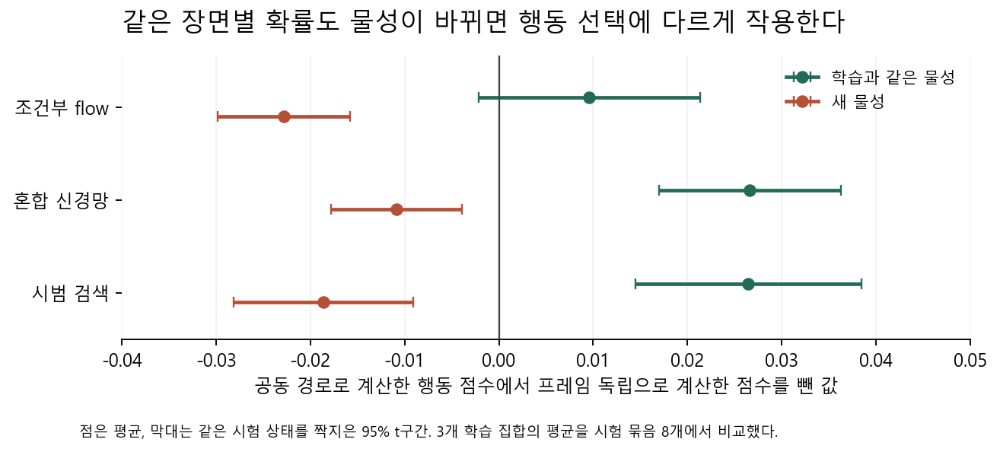

# 모션 리워드에서 월드모델까지 · #34~#38 독립 검증

다섯 연구에서 가장 중요한 구분은 **원하는 수치를 움직였는가**와 **실제로 원하는 행동이나 분포를 얻었는가**다. 같은 조건에서 더 단순한 방법이 같은 일을 할 수 있는지도 확인했다. 아래 수치는 직접 실행한 결과다. 시뮬레이터에서 학습한 결과, 저장 정책을 다시 실행한 결과, 수학적으로 만든 반례를 각각 표시했다.

**판정은 #38을 의사결정 평가 연구로 전환해 1순위, #36 접촉 불확실성을 2순위로 두는 것이다.** #34는 한 환경에서 박자의 인과적 역할이 보였고, 7개 미사용 조건에서는 미리 정한 성공 예측이 3개만 맞았다. #37은 #38의 비교군과 표현 실험으로 통합하고 #35는 일반 가속 주장을 종료한다. 다섯 원안 모두 지금 상위 학회 본회의에 제출할 근거는 부족하다.

## 이미 있던 연구와 이번 산출물

| 주제 | 2026-11-23 확인한 원격 정본과 현지 추가 기록 | 이번 검증 |
|---|---|---|
| #34 리듬을 담는 모션 보상 | [원래 스타일 설계](https://github.com/duckychoi/note/blob/3d8ab448e5f1390e0de6cb66cad852c700ed3762/docs/04-style-content-loss.md#L26), [현지 사전등록](../../results/v2/PREREG_34_rest_trap_20261122.md#L4) | [저장 정책과 예측](motion34.json), [토크 재생](rhythm34.json), [세 환경 동작 순서](coordination34.json), [보상별 정책 탐색](search34.json) |
| #35 입자 생성과 정책 선택 | [생성 코드](https://github.com/duckychoi/note/blob/a837ba78dc9ed96de2b48797f126c3441cbcca43/src/toy_pf_vs_euler.py#L45), [현지 정책 관문](../../docs/v2/35_PF_generative_research_note.html) | [새 시드의 원자료](particle35.json) |
| #36 물리 법칙으로 생성물 교정 | [물리-SMC 구현](https://github.com/duckychoi/note/blob/8890945be6e827fc815785a8c0e56fa46ff2667c/src/toy_physics_potential_smc.py#L50) | [정답 분포 검산](physics36.json), [충돌 시험](contact36.json), [관측 복원](bounce36.json), [미래 생성](forecast36.json) |
| #37 확률적 미래 표현 | [조건부 flow 구현](https://github.com/duckychoi/note/blob/b52cd304f001f5b93c7d824c888390467d27ca3b/src/toy_generative_jepa.py#L34) | [분포 비교](future37.json), [행동과 배경 분리](representation37.json) |
| #38 행동 조건부 월드모델 | [모델 제안](https://github.com/duckychoi/note/blob/12fd6de97b79069c056b2d2cd658482ea290c62f/README.md#L14) | [네 장면 시험](planning38.json), [직접 학습한 flow](flow38.json), [임의 길이 반례](horizon38.json), [MuJoCo 행동 선택](catch38.json), [보정 뒤 재시험](calibration38.json) |

원격에 올라온 다섯 커밋과 로컬의 미커밋 후속 검증을 같이 읽었다. 기존 작업 브랜치의 수정 사항을 보존하기 위해 원격 #35~#38은 작업 공간의 `research-sources`에 별도 체크아웃했다. 첫 비교를 정한 시점과 후속 탐색을 구분한다. [초기 검증 설계](protocol.md)

## #34 · 박자에 반응하는가, 전문가처럼 움직이는가

본래 목적은 시범만 보고 동작의 리듬과 연속성을 평가하는 스칼라 보상을 얻는 것이다. 시계 신호에 맞춰 관절 토크를 반복해도 몸은 앞으로 갈 수 있다. 따라서 전진 속도, 관절끼리 움직이는 순서, 물리적으로 계속 걸을 수 있는 능력은 각기 검증할 필요가 있다. 시범을 따르는 물리 캐릭터 학습과 열린고리 보행 자체에도 선행연구가 있다. [개념의 출발점](https://github.com/duckychoi/lab/blob/main/wiki/concepts/phase-rope-flowmatching-motion-reward.md) · [DeepMimic](https://xbpeng.github.io/projects/DeepMimic/) · [열린고리 보행 대조군](https://arxiv.org/abs/2310.05808)

**같은 시작 상태에서 시계만 바꾼 실험.** HalfCheetah-v5의 30만 스텝 저장 정책 12개를 새 출발점 12개에서 각각 500스텝 굴렸다. 전진거리를 걸린 시간으로 나눴다. 조건별로 학습 시드는 3개이므로 36개 롤아웃을 독립 학습 36회로 세면 안 된다.

| 학습 보상 | 시계 진행 → 시계 고정, m/s | 정상 시계에서 전문가 절반 속도 초과 |
|---|---:|---:|
| 무위상 | −0.001 → −0.001 | 0/36 |
| 위상표 뒤섞은 FiLM | 0.002 → −0.003 | 0/36 |
| 정상 위상표 FiLM | **1.967 → 0.0004** | **0/36** |
| 위상 AMP | 10.165 → 1.699 | 34/36 |

정상 FiLM의 세 정책은 각각 1.45, 2.26, 2.19 m/s였다. 같은 구조의 뒤섞은 표로 훈련했을 때 전진이 사라진다. 시계를 고정하는 조작은 훈련 분포 밖이므로, 이것만으로 내부 리듬의 유무를 단정할 수 없다. FiLM 방식은 위상별 보상망 하나를 세 정책이 공유한다. 보상망 자체를 세 번 독립 학습한 실험은 아니다. [정책·시드별 원자료](motion34.json)

**몸을 보지 않고 토크만 재생한 실험.** 별도 12개 출발점에서 각 정책의 토크를 수집해 위상의 사인·코사인 4개 고조파에 회귀했다. 이를 또 다른 12개 출발점에서 그대로 재생했다. 정상 FiLM은 토크 변화의 91.6%가 회귀로 설명됐고, 몸 상태를 읽을 때 1.965 → 토크만 재생할 때 1.134 m/s였다. AMP는 10.300 → 0.351 m/s였다. 관절 간 한 스텝 지연 공분산의 전문가 기준 상대거리도 계산했다. 전문가끼리는 0.050, AMP는 0.510, 정상 FiLM은 0.981, 뒤섞은 FiLM은 약 1.000이었다. 거리 1은 전문가 기준 행렬 크기만큼 차이가 난다는 뜻이다. 속도 차이도 이 거리에 영향을 미치며 독립적인 스타일의 인과효과는 아니다. [실험 코드](rhythm34.py) · [원자료](rhythm34.json)

**내부 리듬 보상 후보.** 양 관절의 움직임을 녹화해 거꾸로 틀어도 각 관절의 주파수별 세기와 같은 시각의 관절 공분산은 같다. 반면 “왼쪽이 오른쪽보다 먼저 움직였나”는 바뀐다. 관절 푸리에 계수의 곱 $F_i(f)\overline{F_j(f)}$은 동작 전체를 같은 만큼 순환 이동해도 보존되며, 시간을 뒤집으면 허수부의 부호가 바뀐다. 더 싼 비교식 $A_{ij}=\langle x_i(t)x_j(t+1)-x_j(t)x_i(t+1)\rangle$도 순서에 민감하다. 이 식들은 고전 교차스펙트럼과 시차 공분산이다. 우리 검증은 원래 노트의 스펙트럼 제안을 실제 관절·정방향·역방향에 구체화했다. [원래 Gram 설계](https://github.com/duckychoi/note/blob/3d8ab448e5f1390e0de6cb66cad852c700ed3762/docs/04-style-content-loss.md#L26)

세 환경에서 전문가 10개 에피소드로 기준을 정했다. 128프레임에서 HalfCheetah·Hopper·Walker2d의 미사용 전문가 각 64개에 대해 정방향과 역재생을 구분한 비율은 단일 관절 스펙트럼·동시점 공분산 0.50, 시차 면적·교차스펙트럼 1.00이었다. 동점은 0.5다. 시점을 일괄 이동한 동작은 모두 동점이었다. 실제 medium과 expert 구분은 단일 관절 스펙트럼만으로도 세 환경에서 AUC가 1.00이었다. 역재생은 합성 조작이고 실제 보행을 잘하는지는 별개의 문제다. [32·128·256프레임 전체 결과](coordination34.json)

학습 전 보상 비교의 선행에 EPIC와 DARD가 있고, 모션 분야에는 SMP 및 온라인 수송 보상 FMP가 있다. 진단의 신규성 후보는 몸 상태를 읽지 않는 주기적 제어와, 물리적으로 실행 가능한 정지·출발을 구별한 뒤 실제 정책 실패를 예측하는 부분이다. [EPIC](https://arxiv.org/abs/2006.13900) · [DARD](https://arxiv.org/abs/2201.10081) · [SMP](https://arxiv.org/abs/2512.03028) · [FMP](https://arxiv.org/abs/2609.15631)

**보상을 실제로 최적화하면.** HalfCheetah의 6개 모터에 두 고조파와 상수항을 쓰는 30변수 제어기를 CEM으로 탐색했다. 방법당 후보 48개 × 5세대, 세대당 공통 출발점 2개, 후보 선정용 출발점 4개, 별도 평가 12개, 독립 탐색 시드 5개다. 192스텝을 실제 물리로 실행했다. 같은 토크를 입력한 Gymnasium과 저수준 MuJoCo의 검산 궤적 좌표 차이는 0이었다. 속도만 최대화하면 **1.580 m/s**, 단일 관절 스펙트럼 보상만 쓰면 **0.092**, 시차 면적만 쓰면 **−0.554**, 교차스펙트럼만 쓰면 **0.080**이었다. 역재생을 완벽히 식별해도 정책이 올바른 방향으로 전진한다는 보장은 없다. [실행 코드](search34.py) · [원자료](search34.json)

추가로 새 탐색 시드 5개에서 목표 속도 1.2 m/s와 바른 몸통 자세를 주고, 양쪽에 동일한 후보 예산을 적용했다. 과제만 최적화한 경우와 과제에 교차스펙트럼 거리를 더한 경우 모두 60/60회에서 1 m/s 및 바른 자세 90%를 넘었다. 교차스펙트럼 상대거리는 1.004 → 0.994로 차이가 작았다. 이 정책 클래스에서 고도화한 스타일 항을 큰 성능 개선으로 보고할 근거는 약하다. 이 탐색과 30만 스텝 SAC는 서로 다른 실험이다. [과제 보상을 함께 쓴 원자료](task34.json)

**사전 예측은 어떤 박자를 읽었나.** 기존 진단은 보행 시범에는 전체 궤적에서 사후 추출한 위상을, 서 있는 기준 동작에는 외부 시계를 붙였다. 사전등록과 같은 보행 20개 및 저장된 정지 기준을 쓰고 정상 FiLM의 점수를 CPU에서 다시 계산했다. 시범의 자체 위상을 쓸 때 중간 품질 보행이 정지를 이기는 비율은 HalfCheetah 0.95, Hopper 1.00, Walker2d 1.00으로 원 수치를 복원했다. 시범의 관절 궤적은 유지하고, 위상을 전문가 주기의 외부 시계로 바꿔 출발 위상 4개에서 평균하자 세 값이 전부 **0.00**이 됐다. 이 변경은 사후 민감도 분석이다. HalfCheetah 정상 FiLM이 실제로 전진했다는 보정점까지 놓치므로 이를 새 정답 규칙으로 채택할 수 없다. 향후 진단은 정책이 스스로 달성할 수 있는 동작과 시계의 결합을 평가해야 한다. [시범별 원자료](clock34.json) · [기존 위상 처리](../../src/v2/il/diag_rollout_predict.py#L110)

**사전등록 7개 조건의 최종 성적.** 각 조건의 학습 시드 3개, 총 21개 파일 모두 30만 스텝과 정상 시계 최종 평가를 확인했다. 기존에 보정에 쓴 HalfCheetah 무위상과 정상 FiLM은 아래 시험에서 제외했다. 탈출 기준은 미리 고정한 시드 평균 속도 1.0 m/s다. 여기서 정지는 기준 미달을 가리키며 완전한 무동작과 같지 않다.

| 미사용 시험 조건 | 새 진단 | 기존 진단 | 최종 평균 m/s | 새 판정 |
|---|---|---|---:|---|
| HalfCheetah 뒤섞은 위상 | 정지 | 정지 | 0.003 | 적중 |
| Hopper 무위상 | 정지 | 탈출 | 0.002 | 적중 |
| Hopper 위상 | 탈출 | 탈출 | 0.124 | 오류 |
| Hopper 뒤섞은 위상 | 정지 | 탈출 | 0.073 | 적중 |
| Walker2d 무위상 | 탈출 | 탈출 | −0.017 | 오류 |
| Walker2d 위상 | 탈출 | 탈출 | 0.153 | 오류 |
| Walker2d 뒤섞은 위상 | 탈출 | 탈출 | 0.018 | 오류 |

새 진단 **3/7**, 기존 진단 **1/7**, 항상 정지 **7/7**이다. 새 진단의 탈출 예측 4개가 전부 틀렸다. 실제 탈출 조건이 없으므로 성공 조건을 찾아내는 민감도는 이 시험에서 계산할 수 없다. 정지·탈출 사례를 본 뒤 문턱을 고쳐 이 7개를 다시 시험으로 세면 안 된다. [사전등록 문서](../../results/v2/PREREG_34_rest_trap_20261122.md#L4) · [7개 조건과 시드별 최종 속도](motion34.json)

## #35 · 입자 재표집이 연산 값을 하는가

**생성판.** 원 2차원 가우시안 혼합에 256입자, 새 시드 12개, 같은 속도장 호출 수를 적용했다. 에너지 거리의 표본 추정치는 작을수록 좋다. 4회에서 Euler 0.078, Heun 0.098, 원 가중 SMC 0.199였고, 8회에서는 각각 0.037, 0.029, 0.436이었다. 이 비교의 SMC는 추가 이동을 끈 버전이며 밀도 조회와 입자 간 거리 계산은 무료로 쳤다. 원 코드에는 재표집 기준을 넘지 않은 가중치를 최종 표본에 반영하지 않는 경로도 있다. 이 숫자로 SMC 일반의 성능을 판단할 수 없다. 재활성화하려면 별도 모델에 없는 정확한 밀도를 요구하지 않으면서 호출 수·연산량을 함께 맞춰야 한다. [원 코드](https://github.com/duckychoi/note/blob/a837ba78dc9ed96de2b48797f126c3441cbcca43/src/toy_pf_vs_euler.py#L53) · [새 결과](particle35.json)

**생성판을 고쳐서 다시 시험한 결과.** 이전 입자의 정규 혼합 제안을 만들 때 이전 가중치를 반영하고, 마지막에도 가중치를 보존했다. 제안 폭은 검증 시드 6개에서 정했다. 2차원 혼합가우시안까지의 모집단 에너지 거리는 각 성분 사이 거리의 Rice 평균으로 직접 계산해 정답 표본의 잡음도 없앴다. 새 시드 12개 결과에서 **정확한 중간 밀도를 외부에서 무료로 받을 때** 속도장 4회 기준 교정 입자법 0.00518, Heun 0.09864로 좁은 양성 결과가 생겼다. 8회에서는 기본 Heun 0.01337, 교정 입자법 0.00415, Sobol 초기점을 쓴 Heun **0.00222**였다. 속도장을 완전히 뺀 밀도 전용 입자법은 4회·8회에서 0.02478·0.01457이었다. 밀도와 속도장이 각각 기여한다.

같은 컴퓨터, 단일 BLAS 스레드에서 256개 표본 생성 시간 중앙값은 4회 교정 입자법 약 5.5 ms, 32회 Sobol–Heun 약 2.2 ms였다. 후자의 모집단 거리는 0.00053이었다. 이는 2차원 수치 모형에서의 시간이다. 신경망의 배치 처리에서는 다시 측정해야 한다. 원래의 “속도장만 쓰는 보통의 flow를 더 싸게 대체한다”는 주장을 지지하지 않는다. QMC를 입자법에도 적용할 수 있으며 이 비교는 특정 구현 간 결과다. [교정·모집단 거리 코드](importance35.py) · [원자료](importance35.json) · [Sequential Quasi-Monte Carlo](https://arxiv.org/abs/1402.4039)

**정책판.** 원 8차원 실험에서 별도 검증용 데이터로 선정한 설정을 고정했다. 좁은 오차 봉우리를 갖는 가치 추정기에서 새 시드 12개당 256번 결정했다. 실제 기대 가치가 높을수록 좋다.

| 호출 예산 상한 | 끝에서 한 번 선택 | 중간 재표집 | 기울기 유도 | 유도와 재표집 |
|---|---:|---:|---:|---:|
| 64 | **−0.271** | −0.453 | −0.301 | −0.937 |
| 256 | −0.140 | −0.115 | **−0.112** | −0.123 |

256에서 끝점·중간 재표집은 모두 실제 255회, 기울기 유도는 231회, 결합은 246회였다. 같은 상한에서 기울기 유도와 중간 재표집의 짝지은 차이는 +0.0032, 시드 기준 95% t구간 −0.0048~+0.0113이다. 목적이 분포 재현인지 최고 가치 행동 선택인지에 따라 최적 규칙이 달라진다. 단순한 예로, 후보 가치 0과 2를 50%씩 뽑으면 평균은 1이고 매번 2를 고르면 평균은 2가 되지만 원래 분포는 사라진다. 기존 종료 판정을 유지한다. 잘 정의된 조건부 샘플링은 #36에서 활용할 수 있다. [원래 공정 비교](../../src/v2/pf/e35p_gate.py#L4) · [TDS](https://arxiv.org/abs/2306.17775) · [Feynman–Kac Correctors](https://arxiv.org/abs/2503.02819)

## #36 · 공이 실제로 튈 때 어떤 물리 법칙을 적용할까

**목표분포의 정답.** 원 toy에서 궤적 $y=b+X\beta+\epsilon$은 중력 포물선 $b$, 초기 높이·속도 $X\beta$, 독립 잡음 $\epsilon\sim N(0,\sigma^2 I)$의 합이다. 2차 차분 $S$는 $SX=0$이므로 물리 위반량은 $E=\|S\epsilon\|^2$다. 원래 표본분포에 $\exp(-\lambda E)$를 곱하면 높이·속도의 사전분포는 보존되고 잡음 공분산은 다음과 같다.

$$
\Sigma_\lambda=(\sigma^{-2}I+2\lambda S^\top S)^{-1},\qquad
\mathbb E_\lambda E=\mathrm{tr}(S\Sigma_\lambda S^\top).
$$

원래 24시점·잡음 0.22에서 $\lambda=2$이면 정답은 **2.1974**다. 원 코드의 결정론 경사 0.012, 입자판 0.041을 그대로 재현했다. 같은 가중치를 6번 거듭 곱하고 물리 에너지만 따라가는 이동을 쓰면 선언한 목표분포를 보존하지 않는다. 이동을 빼고 최종 강도를 12로 해석해도 정답은 0.5919다. 속도 한 개의 표준편차가 그럴듯해도 전체 분포는 틀릴 수 있다. [원 코드](https://github.com/duckychoi/note/blob/8890945be6e827fc815785a8c0e56fa46ff2667c/src/toy_physics_potential_smc.py#L50)

| 같은 2,000입자, 시드 12개 | 평균 물리 에너지 | 곡률 2차 모멘트의 상대오차 |
|---|---:|---:|
| 원 물리-SMC | 0.041 | 0.989 |
| 끝에서 한 번 가중 | 2.190 | 0.345 |
| 온도 증가분 가중 + pCN 수락/거절 이동 | **2.202** | **0.091** |
| 정확한 분포에서 직접 추출 | 2.201 | 0.087 |

교정판은 매번 $\exp[-(\lambda_{j+1}-\lambda_j)E]$로 가중한다. 초기 높이와 속도를 조건으로 가우시안 잡음의 사전분포를 보존하는 제안을 쓰고, 현재 강도에서 수락·거절한다. 표의 입자 수는 같고 계산량은 다르다. 선형 문제에서는 행렬 하나로 정확 표본을 얻을 수 있다. 물리 적용, 조건부 입자 샘플링, 사건 확률 추정에는 직접적인 선행연구가 있다. [재현 코드](physics36.py) · [물리계 사건 샘플링, ICML 2023](https://proceedings.mlr.press/v202/finzi23a.html) · [PhysDiff](https://nvlabs.github.io/PhysDiff/)

**실제 충돌을 구분한 후속 실험.** 공중에서는 중력에 따른 포물선이 맞지만 바닥에 닿으면 속도가 급변한다. 충격 15%를 섞은 합성 데이터에서 꺾임 시각을 모르는 한 번의 충격 모형은 깨끗한 위치에 대한 RMSE를 0.382 → 0.069로 낮췄다. 이 성공을 확인한 뒤 MuJoCo 구체·평면 접촉으로 옮겼다. 다음 단계마다 새 시드를 썼다.

| 무엇을 검증했나 | 기존 → 새 비교 | 해석 |
|---|---|---|
| 관측한 24프레임 복원, 1,152회 낙하 중 772회 접촉 | 단일 포물선 88.1 mm → 충격 1회 14.2 mm → 단순 7프레임 평활 10.5 mm | 합성에서 맞았던 단일 충격이 실제 접촉 전후를 충분히 설명하지 못했다. |
| 관측 복원, 새 감쇠 물성 3종, 별도 1,152회 | 평활 10.51 mm → 최적 반발 궤적 하나 7.75 mm → 반발 후보 평균 **6.36 mm** | 바닥과 중력을 알고 높이·초기 속도·반발계수 24,140개 조합을 고려하면 평활보다 오차가 약 40% 작아졌다. 짝지은 차이의 시드 기준 95% t구간은 3.98~4.33 mm다. |
| 처음 12프레임만 보고 다음 12프레임 생성, 다시 새 감쇠와 새 출발점 | 같은 2,048후보에서 반발 모형 0.0259 → 시뮬레이터 예제 검색 **0.0239** | 미래 궤적 에너지 점수는 작을수록 좋다. 차이의 95% t구간은 0.00086~0.00311이다. 최종 높이가 20 cm를 넘길 확률의 Brier 오차도 0.1384 → **0.1248**이었다. |

평활 폭과 확률 가중의 온도는 별도 검증 세트에서 정했다. 예제 검색은 학습 측 물성으로 시뮬레이터를 호출해 궤적을 준비할 권한이 있다. 해석적 모형은 바닥 높이·중력·충돌 구조를 알고 있었다. 둘의 정보 비용이 다르다. 마지막 실험에서 가중 평균이나 여러 표본이 최적 후보 하나보다 나은 결과와, 해석적 물리 모형이 단순 예제 검색에 뒤진 결과를 함께 기록한다. [충돌 시각 검증](contact36.py) · [복원 코드](bounce36.py) · [미래 생성 코드](forecast36.py)

**연구로 남는 질문.** 물리 법칙을 추가할 때 충돌 발생 여부·시각·반발계수의 불확실성을 얼마나 줄이면서 희귀한 실제 충돌의 빈도는 유지하는가? 다음 관문은 학습에 쓰지 않은 비선형 마찰·다중 물체에서 관측 prefix만 제공하고 충돌 빈도, 궤적 분포와 비용을 같은 표에 놓는 것이다. 같은 시뮬레이션 예산의 검색, 물리 모델 하나, 단순 궤적 혼합을 모두 넘어야 생성 방법 자체의 기여가 선다.

## #37 · 갈림길을 복원하는 것과 중요한 갈림길을 보존하는 것

제곱오차로 점 하나를 맞히면 최적값은 조건부 평균이다. 미래가 같은 확률로 −2 또는 +2라면 최적 평균 0은 실제로 거의 일어나지 않는다. 분포를 학습할 이유는 충분하다. 다만 원 toy의 문맥과 미래는 숫자로 주어지며 인코더도 픽셀도 없다. 원 코드를 재실행해 가운데 문맥에서 왼쪽 0.41, 오른쪽 0.36을 재현했다.

같은 학습 자료 3,000개, 새 학습 집합 12개, 문맥 5개, 방법당 표본 384개를 썼다. 아래 값은 실제 미래분포까지의 1차원 Wasserstein 거리다. 작을수록 좋다.

| 미래 | 조건부 평균 | 조건부 단일 가우시안 | 원 6단계 flow | 비슷한 문맥에서 한 번 재표집 |
|---|---:|---:|---:|---:|
| 두 방향이 반반 | 2.000 | 0.947 | 0.345 | **0.183** |
| 문맥에 따라 희귀 방향이 바뀜 | 0.902 | 0.738 | 0.328 | **0.173** |

두 번째 조건에서 재표집의 우위는 0.155, 짝지은 시드 기준 95% t구간은 0.137~0.172였다. 저차원·충분한 주변 데이터에서는 한 번의 경험 재표집이 강한 기준이다. 이 실험으로 신경망 flow나 고차원 예측의 순위를 정할 수는 없다. [실험 구현](future37.py)

**고도화한 표현 실험.** 실제 분기와 배경 무늬를 섞어서 두 숫자로 보이게 하고, 한 축만 보존할 수 있게 했다. 로그에서는 행동과 배경이 같은 숨은 변수에 묶이고, 무작위 개입에서는 행동만 따로 바뀐다. 배경 진폭이 4배일 때 두 카메라의 배경을 독립적으로 바꾸면 두 시점이 공유하는 축을 찾는 CCA가 분기를 거의 100% 복원했다. 배경까지 공유하면 **49.6%**로 내려갔다. 로그 행동의 상관으로 고른 축은 50.0%, 무작위 행동 1,024개로 고른 축과 정답 표지 64개로 지도학습한 축은 약 100%였다. 모든 방법에서 축의 방향과 분류 경계에 같은 표지 64개를 썼다. 이 조건을 밝히지 않으면 무표지 성능으로 오해할 수 있다. [표현 실험](representation37.py)

관측 분포가 중요한 분기와 배경을 바꿔도 같다면 분포 적합도만으로 둘을 식별할 수 없다. 이론 후보는 무엇이 행동 개입에 반응하는지 명시한 식별 조건이다. 배경 교란과 제어 가능한 상태 구분도 이미 연구됐다. 별도 논문보다 #38의 인코더·교란 대조군으로 넣는 편이 낫다. 특히 **Flow-JEPA**가 이미 행동 조건부 미래 잠재 궤적을 flow로 생성하며, **MDN-VJEPA**는 혼합분포로 분기와 계획을 평가했다. [Flow-JEPA](https://arxiv.org/html/2608.29029v3) · [MDN-VJEPA](https://arxiv.org/abs/2610.13956) · [외부 교란 속 상태 학습](https://proceedings.mlr.press/v178/efroni22a.html)

## #38 · 같은 장면별 정확도에서 행동이 달라지는 조건

**원 주장 교정.** 행동 조건부 미래 궤적을 가우시안 잡음에서 flow로 생성하고 SIGReg 인코더와 결합하는 연구가 이미 있다. SIGReg가 조절하는 것은 전체 영상에서 모은 잠재 벡터의 주변분포다. 특정 행동·특정 과거 뒤에 나타나는 미래의 조건부분포는 훨씬 좁거나 여러 갈래일 수 있다. RoPE의 상대위치 성질도 동역학 오차를 자동으로 줄여 주지 않는다. 한 스텝 회전 속도를 0.40 대신 0.42라 학습한 단위원 반례에서 상대위치 내적의 평행이동 오차는 $8\times10^{-16}$이지만 누적 위치 오차는 1스텝 0.020 → 64스텝 1.194다. 이 반례는 특정 RoPE 트랜스포머의 성능 측정과 구별한다. [Flow-JEPA의 SIGReg·CFM 설명](https://arxiv.org/html/2608.29029v3) · [LeWorldModel 원문](https://arxiv.org/abs/2603.19312) · [수치 검산](planning38.json)

**RoPE를 실제로 학습한 시험.** 행동이 위상 속도를 바꾸는 진동계에서, 8프레임의 잡음 낀 위치를 보고 다음 위치를 예측하는 인과적 어텐션을 학습했다. 폭 32, 헤드 4개, 같은 자료·업데이트, 학습 시드 3개다. 같은 시험 시각에서 입력 8개 → 32개를 주면 한 스텝 RMSE가 학습형 위치표 0.063 → 0.323, RoPE 0.062 → 0.267, 별도 위치 인코딩 없음 0.078 → 0.228이었다. 학습형 위치표의 뒤쪽 24개 위치는 훈련 중 사용되지 않았다. 입력은 계속 최근 8개로 고정하고 32스텝 앞을 굴리면 학습형 1.004, RoPE 1.066, 위치 인코딩 없음 1.093이었다. 외삽이 필요한 두 축에서 순위가 달라졌다. 이 진동계에서는 RoPE가 긴 예측의 오차누적을 해결한다는 주장이 성립하지 않았다. [학습 코드](rope38.py) · [결과](rope38.json) · [RoFormer](https://arxiv.org/abs/2104.09864)

**짧은 반례.** 원형 트랙 두 개에 좌·우 표시를 다음처럼 써 놓고, 무작위 칸에서 출발한다. 왼쪽과 오른쪽은 두 트랙에서 각각 절반이다. 바로 다음에도 같은 방향일 확률도 둘 다 2/3이다.

| 트랙 | 반복 순서 | 4칸 연속 같은 방향일 실제 확률 | 성공 보상 1, 우회 보상 0.2일 때 |
|---|---|---:|---|
| 일정한 트랙 | `+++---` | 0 | 우회 |
| 불규칙한 트랙 | `+-----+++++-` | 1/3 | 통과 시도 |

한 칸 전이만 맞힌 모델은 두 경우 모두 $(2/3)^3\simeq0.296$을 예측한다. 각 표시의 크기를 독립적인 반정규 난수로 바꾸면 각 장면의 값은 **정확히 표준정규분포**이고 두 장면의 결합분포까지 여전히 일치한다. 이로써 주변분포의 가우시안화만으로 해결되지 않는 계획 오차를 만들었다. 점수 규칙과 시간 의존성에 관한 선행은 오래됐다. 우리의 구체적인 후보는 한 단계 전이까지 일치시킨 환경 쌍, 희귀 사건의 확률, 실제 행동 손실을 같은 시험에 두는 것이다. [다변량 예측에서의 의존성 평가](https://journals.ametsoc.org/doi/10.1175/MWR-D-14-00269.1) · [의사결정 중심 월드모델 평가](https://arxiv.org/abs/2606.15032)

**실제로 학습한 모델.** 각 세계에서 학습 클립 1,024개, 시드마다 별도 학습, 예측당 4,096개 궤적을 생성했다. 실제 성공률은 0%와 33.3%다.

| 모델 | 일정한 트랙 → 불규칙한 트랙의 예측 | 읽는 방법 |
|---|---:|---|
| 한 단계 신경망 flow, 시드 5개 | 20.7% → 21.0% | 두 세계를 거의 구별하지 못했다. |
| 4장면 공동 신경망 flow, 시드 5개 | 8.0% → 23.4% | 양쪽에서 행동 선택은 5/5회 맞았지만 확률 오차가 남았다. |
| 4장면 빈도, 별도 시드 12개 | 0.0% → 33.4% | 단순 집계만으로도 이산 사건을 복원했다. |
| 인접 통계를 유지하며 사건 빈도 하나로 보정, 별도 시드 12개 | 0.7% → 33.4% | 보정하지 않은 다른 사건에서는 57.1%를 예측했으나 참값은 50%였다. |

네트워크는 각 4,545·4,868개 파라미터를 가진 작은 MLP다. 동일한 학습 자료와 업데이트 횟수를 사용했지만 한 단계 모델은 전체 경로에 벡터장 96회, 공동 모델은 32회가 들었다. 입력은 생성된 수치 표현이다. 공개 Flow-JEPA 신경망을 재학습한 결과는 아니다. 범용 월드모델이 해야 할 일과 특정 결정을 맞히는 데 충분한 정보의 차이를 드러내는 대조군이다. [신경망·시드별 결과](flow38.json) · [통계 대조군](planning38.json)

**임의의 길이로 확장되는 이론.** 부호 $s_t\in\{-1,1\}$, 임의의 고정 행동열 $a_t\in\{-1,1\}$, 세계의 종류 $b\in\{-1,1\}$를 두고, 독립 잡음 $e_t$가 확률 $\eta$로 −1이 되게 둔다.

$$s_{t+k}=b\,a_t\,e_t\prod_{j=0}^{k-1}s_{t+j}.$$

첫 $k$개를 균등하게 뽑으면, 행동과 잡음을 고정해도 현재 $k$자리에서 다음 $k$자리로 가는 함수는 일대일이다. 빠진 첫 부호를 나머지 부호와 마지막 부호로 되찾을 수 있기 때문이다. 따라서 어느 세계에서나 연속 $k$자리의 분포는 같다. 그러나 $k+1$자리 곱이 양수일 확률은 $a_t=b$면 $1-\eta$, 반대면 $\eta$다. 같은 비중의 두 세계에서 짧은 분포만으로 같은 선택을 하는 계획기의 평균 성공은 0.5, 올바른 긴 관계를 아는 계획기는 $1-\eta$다. 차이는 $0.5-\eta$다. 한 세계의 종류를 알려 주는 외부 표지나 충분히 긴 학습 클립을 허용하면 그 제약은 풀린다.

$k=2,4,8$과 잡음 10%·35%에서 모든 짧은 상태를 열거해 분포 차이가 0임을 검산했다. 긴 관계식을 알고 그 방향만 32개 독립 시범에서 추정하는 실험에서는 12개 시드에서 최적 행동을 복원했다. 패리티를 이용한 제한 차수 식별 불가능성은 고전적인 확률 구성이다. 기여 후보는 이를 제어 과제로 옮긴 검증 장치이며 일반 식별 이론의 최초 발견이라는 주장은 삼간다. [열거와 표본 실험](horizon38.py) · [제한 차수 식별 불가능성 문헌](https://people.csail.mit.edu/ronitt/papers/Rubinfeld_Xie.pdf)

**물리 시뮬레이터로 옮긴 결과.** 첫 12프레임만 본 뒤, 세 시간대 중 하나를 골라 공을 받거나 일정한 점수를 받고 포기한다. 공 높이가 0.10~0.23 m에 3프레임 연속 머무르면 받기에 성공한다. 포기 점수 0.1·0.3·0.5·0.7·0.9를 똑같이 평가했다. 항상 포기하면 평균 0.500이다. 같은 예측 라이브러리의 장면별 확률을 고정하고, 한 궤적에서 3프레임이 함께 조건을 만족할 확률과 장면별 확률의 곱을 비교했다. 두 방법의 한 장면 예측 차이는 수치상 0이었다. 테스트는 학습에서 보지 않은 감쇠 물성 3종, 24개 출발 시드 묶음, 총 4,608회다. 여기서 “받기”는 궤적 이후 집계하는 보상이며 손과 공의 양방향 충돌 제어는 없다.

| 예측 자료 | 프레임 독립 → 공동 경로의 평균 점수 | 공동 경로의 짝지은 차이, 95% t구간 |
|---|---:|---:|
| 해석적 반발 후보 | 0.5010 → 0.4877 | −0.0154~−0.0113 |
| 훈련 물성의 시뮬레이터 궤적 검색 | 0.4972 → 0.4758 | −0.0237~−0.0191 |

희귀 사건에서는 잘못 추정한 의존성을 그대로 적용하면 자신 있게 실패할 수 있다. 실제 시간대별 성공률은 2.7%, 4.1%, 4.3%였다. 별도 검증으로 새 물성에서 표지 768개를 주고 사건 확률을 보정한 뒤 다시 4,608번 시험했다. 검색 기반 공동 경로 0.5015, 프레임 독립 0.4999, 표지에서 결과를 직접 찾은 최근접 이웃 0.5026이었다. 공동 경로와 직접 검색의 차이 95% 구간은 −0.00246~+0.00023이다. 학습 물성 표지만으로 보정한 공동 경로는 0.4850이었다. **합성 반례의 이론은 살아 있지만, 실제 계획 수익을 올리는 새 알고리즘이라는 증거는 아직 약하다.** [공 받기 원자료](catch38.json) · [추가 보정 원자료](calibration38.json)

**행동이 미래를 실제로 바꾸는 추가 시험.** 앞 실험의 한계를 확인하려고 MuJoCo 상태를 복사한 뒤 같은 공에 −0.8, 0, +0.8 m/s의 속도 변화를 각각 가했다. 모델에는 잡음 낀 첫 12프레임과 선택할 행동만 준다. 목표는 이후 지정한 3프레임 동안 높이 구간을 유지하는 행동을 고르거나 포기하는 것이다. 항상 포기한 점수는 이 실험에서 0.250이다. 자료당 무작위 행동 3,072개로 12프레임 공동 신경망 flow, 가우시안 4성분 혼합 신경망, 행동별 최근접 시범 32개를 맞췄다. 학습 집합 3개와 물성별 미사용 물리 상태 512개에 세 행동의 실제 결과를 모두 생성했다. 같은 학습 시드들이 같은 시험 상태를 보므로 총 시험 상태 수를 3배로 세지 않는다.

| 방법 | 학습과 같은 물성, 독립 → 공동 | 새 물성, 독립 → 공동 |
|---|---:|---:|
| 학습한 조건부 flow | 0.289 → **0.299** | **0.237** → 0.214 |
| 가우시안 혼합 신경망 | 0.280 → **0.307** | **0.241** → 0.231 |
| 행동별 시범 검색 | 0.288 → **0.314** | **0.247** → 0.228 |

같은 물성에서는 세 방법 모두 공동 경로의 행동 점수가 올랐다. 감쇠 물성만 바꾸자 세 방법에서 방향이 뒤집혔다. 새 물성에서는 항상 포기하는 값 0.250도 넘지 못했다. 행동별 사건의 실제 빈도가 약 11~16%에서 4~6%로 달라졌다. 각 쌍은 같은 예측 분포에서 장면별 확률을 유지한 채 시간 의존성만 다르게 썼다. flow에는 행동당 96표본·16회 적분을 썼고 혼합 신경망의 사건 확률은 해석적으로 적분했다. 이는 모델별 동일 시간 비교로 해석할 수 없다. 물성 변화가 있는 시각 환경에서 **관절·물체 상태의 예측 오차와 행동 후 사건 확률의 오류를 분리하는 시험**이 #38의 다음 기여 후보다. [학습과 물리 분기 코드](action38.py) · [행동 시험 원자료](action38.json)



3개 학습 결과를 각 시험 묶음에서 먼저 평균한 뒤 짝지은 95% t구간을 계산했다. 학습과 같은 물성에서 flow의 차이는 +0.0096이며 구간은 −0.0022~+0.0213으로 0을 포함한다. 새 물성의 차이는 −0.0228이며 구간은 −0.0299~−0.0158이다. 물성 세 종 전체를 무작위로 뽑은 모집단에 대한 구간은 아니다. [그림 생성 코드](figure38.py)

**고도화한 행동 규칙도 시험했다.** 세 장면 각각의 예측 성공확률이 $p_1,p_2,p_3$라면 셋이 함께 성공할 확률은 $L=\max(0,p_1+p_2+p_3-2)$와 $U=\min_i p_i$ 사이다. 예측한 시간 의존성이 얼마나 믿을 만한지 모를 때 후보 행동을 $L$로 보수적으로 채점하는 규칙을 처음 쓰는 시험 상태에서 평가했다. flow의 새 물성에서 추정한 공동확률 → 하한 규칙의 행동 점수는 0.201 → 0.249였고, 학습과 같은 물성에서는 0.315 → 0.250으로 내려갔다. 항상 포기하면 0.250이다. 하한은 손실을 줄였지만, 어느 물성에서 적극적으로 행동할지를 해결하지 못했다. 식은 입력된 주변확률에 대한 고전적 Fréchet 경계이고, 주변확률 자체가 틀리면 실제 세계의 성공을 보장할 수 없다. [독립 시험 상태 결과](bounds38.json)

## 재현 방법과 해석 범위

### 상위 학회 기준으로 다음에 투자할 순서

| 우선순위 | 살릴 질문 | 다음 관문과 중단 조건 |
|---|---|---|
| 1 · #38 의사결정 평가 | 같은 장면별 예측을 고정할 때 시간 의존성이 언제 행동 선택을 돕고, 물성 이동에서 언제 해치는가? | 공 받기 외에 마찰이 달라지는 밀기와 시각 기반 접촉 과제를 사전 지정한다. 같은 시작 상태의 여러 행동을 물리 엔진으로 분기하고, 공개 Flow-JEPA·혼합 예측기·경험 검색을 같은 데이터 및 추론 시간으로 평가한다. 사건 빈도와 항상 포기하기를 함께 공개한다. 새 환경에서 현재의 순위 반전이 재현되지 않으면 사례 연구로 범위를 좁힌다. |
| 2 · #36 불확실한 접촉 법칙 | 실제 접촉의 빈도를 지키면서 틀린 움직임만 걸러낼 수 있는가? | 마찰과 다중 접촉을 보지 못한 생성 모델에 물리 정보를 추가하고, 같은 시뮬레이터 호출 예산에서 미래 궤적 점수·충돌 확률·시간을 측정한다. 검색과 표준 입자법을 넘지 못하면 추론 알고리즘 논문은 보류한다. |
| 3 · #34 모션 리워드 진단 | 앞으로 가는 주기 토크와 전문가다운 관절 협응을 보상 하나가 구분하는가? | 신체 피드백 없이 움직이는 제어기, 실제 정지 상태, 역순·다른 협응을 대조한다. 학습 실패 판정에는 알려진 정지와 탈출이 모두 있는 미사용 과제·보상망을 확보한다. 항상 정지 예측과 단순 속도·시차 기준을 넘는지 사전 평가한다. |
| 4 · #37 표현 검증 | 행동이 바꾸는 미래와 행동과 무관한 배경을 분리하는가? | #38에서 같은 인코더·같은 데이터로 배경만 교란하고 확률·계획 순위를 비교한다. MDN과 직접 재표집이 강한 기준이다. |
| 5 · #35 종료 유지 | 정확한 중간 밀도를 쓸 때의 제한적 저스텝 이득 | 일반 생성 가속과 RL 정책 우위 주장은 종료한다. 조건부 샘플링·제안 보정은 #36 실험의 대조 방법으로 남긴다. |

**투고 판단.** #38의 후보 기여는 이미 있는 “행동 조건부 flow JEPA”에 모듈을 보탠 사실보다, 장면별 점수를 같게 유지한 채 시간 의존성 하나가 물성 변화 전후의 의사결정을 어떻게 바꾸는지 측정하는 실험에 있다. 현재의 결과는 정해진 저차원 환경과 저차원 모델에 한정된다. 공개 시각 모델과 서로 다른 실제 제어 과제에서 이 효과가 재현되어야 상위 AI 학회 본회의에 낼 근거가 생긴다.

### 코드 실행

실험 코드는 같은 이름의 JSON을 자기 폴더에 기록한다. 과제 보상을 더한 CEM 실험은 `search34.py --with-task`로 실행해 `task34.json`을 기록한다. 그림 코드는 `action38.png`를 만든다. #34 정책 평가에는 기존 SAC 정책 체크포인트·Minari 에피소드·사전등록 실행 파일이 필요하다. 학습한 원본 모델은 현지 `E:/0.Project/fm34_env`에 있다. #35는 현지 `note/src/v2/pf`와 `note/results/v2/e35p_gate.json`도 읽는다. #36~#38의 물리 시험은 스크립트에서 MuJoCo 환경과 데이터를 직접 만들고, 원 코드 재사용에는 위 표의 고정 커밋 체크아웃을 쓴다.

이 작업 공간에서 재실행하는 PowerShell 예시다. 무거운 실험은 CPU로 돌렸고 기존 RL 작업의 GPU를 점유하지 않았다. MuJoCo 경고 로그는 실행한 폴더에 생길 수 있다.

```powershell
$run = (Resolve-Path 'note/review/verification_20261123').Path
$physicsPython = 'E:/0.Project/fm34_env/.venv/Scripts/python.exe'
$env:OPENBLAS_NUM_THREADS = '1'
Push-Location ([System.IO.Path]::GetTempPath())
try {
    & $physicsPython (Join-Path $run 'motion34.py')
    & $physicsPython (Join-Path $run 'clock34.py')
    & $physicsPython (Join-Path $run 'rhythm34.py')
    & $physicsPython (Join-Path $run 'coordination34.py')
    & $physicsPython (Join-Path $run 'search34.py')
    & $physicsPython (Join-Path $run 'search34.py') --with-task
    python (Join-Path $run 'particle35.py')
    python (Join-Path $run 'importance35.py')
    python (Join-Path $run 'physics36.py')
    foreach ($name in 'contact36','bounce36','forecast36') {
        & $physicsPython (Join-Path $run ($name+'.py'))
    }
    foreach ($name in 'future37','representation37','planning38','flow38','horizon38','rope38') {
        python (Join-Path $run ($name+'.py'))
    }
    foreach ($name in 'catch38','calibration38','action38') {
        & $physicsPython (Join-Path $run ($name+'.py'))
    }
    & $physicsPython (Join-Path $run 'action38.py') --bounds-test
    python (Join-Path $run 'figure38.py')
} finally {
    Pop-Location
}
```

수치 계산 환경은 Python 3.13.12, NumPy 2.4.4, SciPy 1.17.1, PyTorch 2.11.0이다. 물리 환경은 Python 3.12.13, NumPy 2.5.5, SciPy 1.18.1, Gymnasium 1.4.0, MuJoCo 4.0.1, PyTorch 2.14.1이다. #34 본 실험의 30만 스텝을 처음부터 다시 학습하지 않고 저장 정책과 이번 정책 탐색을 평가했다. 다른 주제의 시드별 원자료와 생성 규칙은 함께 저장했다. 이 문서의 95% 구간은 명시된 독립 시드 묶음에 대한 양측 t구간으로, 새로운 환경에 일반화될 확률을 뜻하지 않는다. 물리 측정값 복원, 미래 궤적 생성, 계획 수익은 각각 평가 대상과 손실함수가 다르다.
